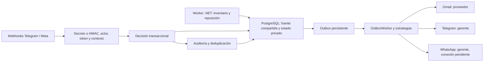

# Agente de inventario y reposición

Servicio independiente en `services/inventory-agent/InventoryAgent.csproj`, con ASP.NET Core **.NET 10**, `BackgroundService`, PostgreSQL/Npgsql y correo mediante MailKit. Su función es revisar inventario, registrar solicitudes de reposición y enviar solicitudes al proveedor: la prioridad **primordial** se procesa automáticamente según la configuración del negocio; los niveles **intermedio y bajo** requieren una aprobación válida del gerente. No repone existencias por enviar un correo ni emite facturas del SRI.

**Estado de activación:** el agente y cada canal comienzan desactivados. Faltan las cuentas, destinatarios y credenciales del negocio; no se han enviado correos o mensajes reales. El código de integración no demuestra un alta de WhatsApp aprobada. Las fuentes y el SQL pueden publicarse en GitHub; alojar el proceso de notificaciones y activarlo queda pendiente de configurar el entorno del negocio.

La aplicación Node existente conserva sus usuarios, pedidos y reglas de dispensación. Este servicio no sustituye su servidor ni modifica su base SQLite. Para producción integrada debe usar el PostgreSQL de la misma farmacia y leer el inventario compartido, sin crear otra copia de existencias.

## Componentes y datos

| Componente | Responsabilidad |
| --- | --- |
| Host ASP.NET Core | Configuración privada, endpoints administrativos y webhooks. |
| Trabajo de fondo | Revisión periódica y revisión diaria a la hora configurada en Ecuador; cancelación y límites por operación. |
| Npgsql | Consultas parametrizadas, transacciones breves y acceso al esquema del agente. |
| `ConfiguracionReposicion` | Proveedor y objetivo de stock por producto; no es un segundo contador de inventario. |
| `SolicitudesReposicion` / `Aprobaciones` | Propuesta, copia de los datos revisados y decisión del gerente. |
| `WebhookInbox` / `Outbox` | Eventos entrantes deduplicados y tareas salientes durables. |
| `AuditoriaPedidos` | Actor, acción, fecha y resultado del proceso de reposición; no contiene conversaciones clínicas. |



El diagrama describe los componentes preparados; agente y canales continúan desactivados.

El esquema predeterminado es `inventory_agent`, separado de las tablas de comercio. Hay dos alternativas SQL **excluyentes**:

- **Integrated**, predeterminada: `sql/002-integrated.sql` lee `public.Producto`, `public.Lote` y `public.Proveedor` mediante vistas. No copia ni actualiza su stock. Los ajustes, reservas y entradas por lote siguen a cargo de la farmacia.
- **Standalone**, demostración aislada: `sql/001-schema.sql` aporta `Medicamentos` y `Proveedores` para ejecutar el ejemplo sin la plataforma Node. No se instala sobre el inventario real ni se usa simultáneamente como otra fuente de verdad.

Después de aplicar uno de esos dos archivos, aplicar `sql/003-agent.sql` para las tablas compartidas del agente. `sql/004-permissions.example.sql` es un ejemplo para un usuario privado `inventory_agent_worker`, previamente creado por el responsable de la base con `NOSUPERUSER` y `NOBYPASSRLS`. Otorga lectura de las columnas de inventario necesarias y políticas del estado privado; no concede acceso a `anon`, `authenticated` ni `PUBLIC`. Las vistas integradas comprueban permisos y políticas del usuario que consulta (`security_invoker`), según [la documentación de PostgreSQL](https://www.postgresql.org/docs/current/sql-createview.html). Los scripts usan el nombre predeterminado `inventory_agent`; si se cambia `Schema` o el nombre del usuario, adaptar y revisar los scripts antes de instalarlos. Las claves administrativas de HTTP no sustituyen los permisos del usuario PostgreSQL.

Antes de la activación se revisa la relación producto/proveedor y los objetivos de reposición con el gerente. No se inventan proveedores, correos, precios, registros sanitarios ni lotes para completar datos faltantes. Si una venta, entrada, caducidad o baja cambia el inventario entre propuesta y aprobación, debe revisarse la propuesta; no se aprueba información obsoleta silenciosamente.

## Recorrido y aprobación entre canales

1. Consultar productos activos, existencia y lotes vigentes de la fuente elegida. Registrar el déficit y los lotes próximos a caducar; la ventana inicial es de **30 días**.
2. Crear una solicitud identificada con el producto, proveedor y cantidad propuesta hasta el objetivo configurado. Mantener una sola solicitud activa por episodio y producto; el proveedor pertenece al snapshot de esa solicitud. Un ciclo del temporizador no debe crear compras repetidas.
3. Para prioridad primordial, registrar la decisión automática y una única tarea de correo al proveedor. Para intermedio y bajo, notificar al gerente sólo por los canales habilitados, conservando un único identificador de solicitud. La alerta no confirma por sí misma una compra.
4. En las solicitudes pendientes de aprobación, verificar identidad, contexto, acción, vencimiento y estado al recibir **[Aprobar Pedido]** o **[Ignorar]**. Consumir la decisión y registrar el trabajo de correo dentro de una transacción.
5. Si llega otra respuesta por Telegram o WhatsApp, devolver la decisión ya tomada o rechazar el conflicto; no crear otro correo. Las solicitudes ya procesadas automáticamente tampoco admiten otra aprobación. Un mensaje libre **OK** no selecciona la última solicitud. La API administrativa configura, concilia y rearma; no ofrece una ruta para aprobar directamente una solicitud pendiente.
6. Después de una aceptación SMTP comprobada, registrar el resultado. Una entrega de mensajería no acredita recepción de mercancía. La entrada real exige el proceso habitual de la farmacia con lote, proveedor y caducidad.

Los tokens son aleatorios y opacos, ligados a solicitud, acción, canal, actor, chat/número, mensaje original y vencimiento. Se almacenan y consumen de forma segura; sus valores no contienen nombre de paciente, receta, dirección ni identificación. El bot no concede permiso de gerente por un nombre de usuario o por reenviar un mensaje. Deben conservarse restricción única y operación condicional sobre una solicitud todavía pendiente para resolver aprobaciones simultáneas.

## Configuración y preparación local

La sección de configuración es `InventoryAgent`. Los valores iniciales son `Enabled=false`, `SourceMode=Integrated`, `Schema=inventory_agent`, `DailyHour=8` con horario de Ecuador y `ExpiryAlertDays=30`. La aprobación vence inicialmente a las 24 horas (`ApprovalHours=24`) y la cola se revisa cada 30 segundos (`OutboxPollSeconds=30`). Cada producto tiene su objetivo de reposición; los canales `Email`, `Telegram` y `WhatsApp`, dentro de `InventoryAgent`, tienen `Enabled=false`. Cambiar una opción no configura automáticamente una cuenta externa.

Las configuraciones de producto usan `ProductoId`, `ProveedorId`, `StockObjetivo`, `DiasAlerta`, `Habilitado` y `Prioridad`. Los valores almacenados de prioridad son `primordial`, `intermedio` y `bajo`. Los canales de aviso al gerente se eligen globalmente: si Telegram y WhatsApp están habilitados, los dos corresponden a la misma solicitud y una decisión consume ambas posibilidades. La solicitud al proveedor se envía por correo.

| Datos privados que faltan | Preparación del dueño |
| --- | --- |
| PostgreSQL | Cadena de conexión del entorno correcto, TLS y cuenta del servicio con permisos mínimos. |
| Administración del agente | `InventoryAgent:AdminApiKey` aleatoria de al menos 32 caracteres, independiente de la sesión de clientes de la farmacia. |
| Correo | Gmail SMTP con 587/STARTTLS o 465/TLS, cuenta remitente autorizada y OAuth2 o contraseña de aplicación; proveedor y destinatario reales revisados. |
| Telegram | Token del bot, secreto del webhook, chat e identificador numérico del gerente autorizado. |
| WhatsApp | Cuenta API elegible, WABA/Phone Number ID, token autorizado, App Secret, Verify Token, número del gerente y plantilla aprobada. |

Guardar secretos únicamente mediante variables privadas del entorno o un almacén de secretos. El proveedor de configuración .NET convierte doble guion bajo en niveles: por ejemplo, `InventoryAgent__ConnectionString`, `InventoryAgent__AdminApiKey`, `InventoryAgent__Email__Password`, `InventoryAgent__Telegram__BotToken` e `InventoryAgent__WhatsApp__AppSecret`. Fuente: [configuración oficial de ASP.NET Core](https://learn.microsoft.com/en-us/aspnet/core/fundamentals/configuration/?view=aspnetcore-10.0). No pegarlos en este documento, `appsettings.json` público, GitHub, ZIP, argumentos, capturas ni registros. La clave administrativa se envía por `Authorization: Bearer` al grupo `/admin`; no por URL. Estos endpoints pertenecen al servicio independiente y no deben exponerse como operaciones anónimas del sitio público. Usar HTTPS al salir del equipo local y limitar tamaños, tiempos y frecuencia de solicitudes.

| Método y ruta del agente | Uso |
| --- | --- |
| `GET /health` | Comprobar el estado del proceso; no devuelve credenciales. |
| `GET /admin/inventario` | Consultar el inventario leído y sus alertas. |
| `GET /admin/solicitudes` | Revisar solicitudes y resultados de reposición. |
| `PUT /admin/configuracion` | Guardar proveedor, objetivos y prioridad de un producto. |
| `POST /admin/solicitudes/{id}/revision` | Conciliar un resultado incierto con evidencia del proveedor. |
| `POST /webhooks/telegram` | Recibir callbacks del bot con secreto y gerente autorizado. |
| `GET /webhooks/whatsapp` | Verificación del webhook de Meta. |
| `POST /webhooks/whatsapp` | Recibir eventos con firma HMAC del cuerpo original. |

La revisión recibe `Resultado` y `ConfirmadoSinRecepcion`. `recibida` registra que el proveedor confirmó la recepción de la solicitud; no registra mercancía. `no-recibida-confirmada` exige `ConfirmadoSinRecepcion=true` antes de volver a intentar un correo incierto. `rearmar` cierra un episodio de revisión, expirado o ignorado cuando no existe correo aceptado, en envío o con entrega incierta; si hubo un intento fallido con resultado seguro, también exige confirmar que el proveedor no recibió la solicitud. El siguiente barrido crea una propuesta nueva con datos actuales. No se usa el rearme para eludir una conciliación de SMTP incierto.

Instalar SDK .NET 10, restaurar dependencias declaradas y seleccionar una base **de prueba**. Aplicar sólo el SQL del modo elegido con una cuenta de instalación; ejecutar el agente con otra cuenta restringida. En modo integrado, habilitar únicamente la lectura necesaria del inventario y las operaciones sobre `inventory_agent`, respetando RLS. No desactivar globalmente la protección de Supabase para facilitar la conexión.

```text
dotnet restore services/inventory-agent/InventoryAgent.csproj
dotnet run --project services/inventory-agent/InventoryAgent.csproj
dotnet test services/inventory-agent/tests/InventoryAgent.Tests.csproj
```

`configuration.env.example` sólo muestra los nombres y valores vacíos: ASP.NET Core no carga ese archivo automáticamente. Cargar las variables privadas mediante el entorno del proceso o el gestor de secretos del alojamiento. Para construir el Dockerfile incluido, el contexto es la carpeta del agente:

```text
docker build -t farmacia-inventory-agent services/inventory-agent
```

El contenedor usa runtime ASP.NET .NET 10, puerto HTTP interno 8080 y usuario no privilegiado. Necesita HTTPS externo y la CA configurada dentro del contenedor mediante un montaje de sólo lectura. `.dockerignore` excluye configuraciones privadas, certificados, pruebas y salidas de compilación; no incorporar las credenciales a la imagen.

El primer arranque debe conservar agente y canales desactivados. La compilación y pruebas sintéticas no necesitan credenciales reales ni cuentas de mensajería. Para activar el entorno del negocio deben estar configurados los destinos autorizados, proveedor, credenciales y webhook correspondiente. La prioridad primordial debe revisarse antes de activar el agente porque sus solicitudes no esperan aprobación humana.

`AllowedHosts` empieza limitado a `localhost;127.0.0.1`. Al alojar el agente, configurarlo para el dominio real de sus webhooks y mantener HTTPS en el acceso externo. La configuración privada se lee al iniciar el proceso: cambiar credenciales del entorno requiere reiniciarlo. La configuración de reposición de cada producto se guarda en PostgreSQL y se utiliza en las siguientes revisiones.

## Alojamiento del proceso

El servicio necesita un proceso permanente con acceso a PostgreSQL, HTTPS para webhooks y salida SMTP hacia Gmail. El plan gratuito de Render bloquea la salida por los puertos **25, 465 y 587**, duerme los servicios web después de **15 minutos sin tráfico entrante** y comparte **750 horas mensuales** entre los servicios gratuitos del espacio de trabajo. Fuente: [limitaciones oficiales de Render gratuito](https://render.com/docs/free). Por esas restricciones, ese plan no permite activar este agente con SMTP ni garantiza su ejecución diaria a la hora elegida.

La farmacia pública puede conservar su servidor Node actual. Las fuentes, pruebas y SQL del agente pueden publicarse en GitHub; su ejecución permanente requiere un equipo o alojamiento compatible, por ejemplo un contenedor .NET en un host con SMTP y HTTPS. Una futura alternativa de correo mediante Gmail API sobre HTTPS necesitaría otra implementación y configuración; este servicio usa SMTP y no incluye esa alternativa.

## Trabajo en segundo plano y PostgreSQL

En .NET 10, todo `BackgroundService.ExecuteAsync` se ejecuta como tarea en segundo plano. El proceso debe propagar `CancellationToken` a esperas, consultas y envíos, y terminar al cerrar el host. La recuperación no puede depender únicamente de `StopAsync`, que podría no ejecutarse ante una caída. Las decisiones y tareas pendientes necesitan persistencia. Fuentes: [cambio de BackgroundService en .NET 10](https://learn.microsoft.com/en-us/dotnet/core/compatibility/extensions/10.0/backgroundservice-executeasync-task), [servicios hospedados](https://learn.microsoft.com/en-us/aspnet/core/fundamentals/host/hosted-services?view=aspnetcore-10.0).

Se recomienda un `NpgsqlDataSource` compartido, conexiones descartadas al finalizar y parámetros SQL. En conexiones remotas, `SSL Mode=VerifyFull` comprueba certificado y nombre del servidor; `Require` sólo exige cifrado. No sustituir la validación por aceptar cualquier certificado. Fuentes: [uso básico de Npgsql](https://www.npgsql.org/doc/basic-usage.html), [seguridad de Npgsql](https://www.npgsql.org/doc/security.html). Un bloqueo o arrendamiento persistente evita que dos procesos generen o despachen la misma tarea; el temporizador no basta como protección de concurrencia.

Para Supabase, descargar la CA oficial de la sección SSL de Database Settings y configurar la conexión Npgsql con `SSL Mode=VerifyFull;Root Certificate=/ruta/CA.crt`. El archivo debe estar disponible dentro del equipo o contenedor del agente. La CA establece confianza en el certificado de la base; no sustituye la contraseña ni otorga permisos. Fuente: [SSL y certificado CA de Supabase](https://supabase.com/docs/guides/platform/ssl-enforcement). No cambiar a `Require` ni aceptar certificados arbitrarios para resolver un fallo de confianza.

## Telegram

Los botones usan `InlineKeyboardMarkup` y `callback_data` de **1–64 bytes**. El webhook devuelve `callback_query`, con `from.id`, `data`, mensaje original e identificador de consulta. Se debe responder con `answerCallbackQuery` para finalizar el indicador del cliente. `setWebhook` permite un `secret_token` propio de 1–256 caracteres y lo envía en `X-Telegram-Bot-Api-Secret-Token`; verificarlo no sustituye validar gerente, chat y token de acción. Deduplicar `update_id` antes de aplicar decisiones. Webhook y `getUpdates` son alternativas excluyentes. Fuente: [Telegram Bot API](https://core.telegram.org/bots/api#callbackquery).

La implementación debe comprobar el gerente por identificador numérico previamente configurado, no por `username`. Un callback con datos manipulados o contexto ajeno no aprueba la solicitud. El token del bot aparece en la ruta oficial de la API: los registros de HTTP deben censurar esa ruta y nunca imprimir errores que la reproduzcan. Se usa HTTPS, cuerpo limitado y sólo eventos necesarios. Un grupo con otros participantes no amplía la lista de autorizados.

## WhatsApp: código preparado, conexión pendiente

Las alertas internas al gerente son distintas de una confirmación de compra del cliente. Esa distinción **no demuestra una excepción** para compras de medicamentos: las restricciones del negocio deben revisarse antes de habilitar mensajes o aprobaciones en WhatsApp. El canal queda desactivado; Telegram configurado permite aprobar solicitudes pendientes, mientras la API administrativa permite configurar, conciliar y rearmar. Ver [política oficial de Meta](https://whatsappbusiness.com/policy/) y [alcance documentado para pedidos](WHATSAPP-PEDIDOS.md).

Fuera de la ventana de atención de 24 horas se necesitan plantillas aprobadas; no se supone que una alerta programada abre esa ventana. Una plantilla con respuesta rápida usa componentes `type=button`, `sub_type=quick_reply` y un parámetro `type=payload` ligado a la acción. El webhook de plantilla utiliza `button.payload`; el de botón interactivo utiliza `interactive.button_reply.id`. Fuente: [ejemplo oficial de Meta para plantilla interactiva](https://www.postman.com/meta/whatsapp-business-platform/request/lwtlz1k/send-message-template-interactive). La configuración requiere `TemplateName` para aprobar o ignorar, `NoticeTemplateName` para el aviso de correo aceptado y `TemplateLanguage` del idioma aprobado. La primera plantilla debe tener un parámetro de cuerpo y dos botones de respuesta rápida en las posiciones 0 y 1; la segunda, un parámetro de cuerpo y ningún botón de aprobación. Los ejemplos actuales de [mensajes de Meta](https://developers.facebook.com/documentation/business-messaging/whatsapp/messages/interactive-reply-buttons-messages/) usan Graph API `v26.0`. La versión se mantiene configurada y debe revisarse al actualizar la API. La categoría de utilidad y el costo se verifican con Meta; no se promete gratuidad.

`/webhooks/whatsapp` debe conservar el cuerpo original y verificar HMAC-SHA256 con App Secret y `X-Hub-Signature-256` **antes de procesar** sus decisiones. El GET valida Verify Token y devuelve `hub.challenge`. También se comprueban WABA/número empresarial, gerente y `context.id` del mensaje enviado; los identificadores entrantes se deduplican. Fuente: [webhooks oficiales Cloud API](https://developers.facebook.com/documentation/business-messaging/whatsapp/webhooks/create-webhook-endpoint/). No se solicitan datos clínicos ni se envían direcciones de clientes por este agente.

## Gmail, MailKit y resultados inciertos

Gmail admite SMTP con OAuth2/XOAUTH2: `smtp.gmail.com:587` con STARTTLS, o 465 con TLS desde la conexión. Para SMTP, el alcance OAuth es `https://mail.google.com/`; una aplicación pública puede requerir verificación y debe cumplir las políticas de Google. Fuentes: [SMTP de Gmail](https://developers.google.com/workspace/gmail/imap/imap-smtp), [XOAUTH2 y permisos](https://developers.google.com/workspace/gmail/imap/xoauth2-protocol). La opción `Email:OAuthAccessToken` recibe un token vigente; este servicio no implementa su renovación automática. El entorno debe renovarlo antes de vencer, o utilizar la alternativa de contraseña de aplicación admitida por la cuenta.

Si se elige contraseña de aplicación, la cuenta debe tener verificación en dos pasos y permitir esa opción; ciertas cuentas de organización, Protección Avanzada o configuraciones con llaves pueden impedirla. No usar la contraseña normal de Gmail ni activar accesos inseguros. Al cambiar la contraseña de la cuenta, Google revoca las de aplicación. Fuente: [contraseñas de aplicación de Google](https://support.google.com/accounts/answer/185833?hl=es).

En MailKit se exige `SecureSocketOptions.StartTls` para 587 o `SslOnConnect` para 465, autenticación apropiada y validación de certificado. No usar `StartTlsWhenAvailable` como sustituto del TLS obligatorio, ni un callback que siempre acepte certificados. No activar el registro completo del protocolo con credenciales o cuerpo del pedido. Fuente: [FAQ oficial de MailKit](https://github.com/jstedfast/MailKit/blob/master/FAQ.md).

Una sola aprobación y una sola tarea de correo pueden garantizarse **dentro de la base de datos**. La entrega SMTP exactamente una vez no se puede prometer: una desconexión después de enviar los datos o una caída después de la aceptación puede dejar resultado incierto y producir duplicados si se reintenta. Esa limitación está descrita en [RFC 5321, sección 6.1](https://www.rfc-editor.org/rfc/rfc5321#section-6.1); la política del agente es conservar el resultado para **revisión manual**, sin reenviar ciegamente. Un `Message-Id` estable ayuda a rastrear el correo, pero no obliga al proveedor a deduplicarlo.

El gerente debe distinguir correo preparado, intento iniciado, aceptación SMTP y resultado incierto. La aceptación del servidor no demuestra lectura del proveedor, aprobación comercial, entrega de mercancía ni entrada de stock. Los reintentos automáticos sólo corresponden a errores donde se sabe que el mensaje todavía no fue enviado; una tarea cuyo envío pudo comenzar no se recupera como si nunca hubiera ocurrido.

## Pruebas y responsabilidades

La ejecución final del 11 de octubre de 2026 aprobó **92 pruebas**: 76 de dominio/HTTP/transportes y 16 de PostgreSQL, sin fallos ni omisiones; NuGet no reportó vulnerabilidades. No se enviaron mensajes reales. Los dos modos de repositorio se probaron en esquemas temporales aislados del Supabase existente, con fuentes ficticias y sin otra copia del inventario real; al finalizar no quedaron tablas temporales y se conservaron los 15 modelos comerciales. El SQL del usuario restringido recibió revisión estática, sin ejecutar las pruebas como ese usuario. Para pruebas posteriores se recomienda un entorno separado; CI utilizará una base PostgreSQL 17 separada. [Resultados y alcance](pruebas/reto2/README.md), [informe consolidado](pruebas/reto2/inventory-agent-results.json).

El responsable técnico prueba con PostgreSQL aislado, proveedores/destinatarios ficticios y adaptadores de transporte simulados. Debe cubrir los dos modos SQL, agente/canales desactivados, lote vencido, solicitud repetida, aprobación simultánea entre canales, gerente ajeno, firma o secreto incorrectos, token vencido/reutilizado, callback sin contexto, caída de base de datos, apagado del host y envío SMTP ambiguo. Las pruebas HTTP de un callback Telegram válido también sustituyen el cliente de `answerCallbackQuery`: quitar los trabajos de fondo no evita por sí solo esa llamada. No utilizar credenciales de producción en pruebas ni configurar webhooks reales automáticamente.

El gerente valida producto/proveedor/cantidad, destinatarios, horarios y decisiones pendientes. El responsable farmacéutico conserva las verificaciones sanitarias y la entrada real por lote. El dueño completa las cuentas y acepta las condiciones de cada canal. La revisión de código debe comprobar permisos mínimos, privacidad de secretos y estados persistidos; los resultados de pruebas concretas se documentan cuando hayan sido ejecutadas, sin presentar estas responsabilidades como certificación sanitaria o aprobación de plataformas externas.
