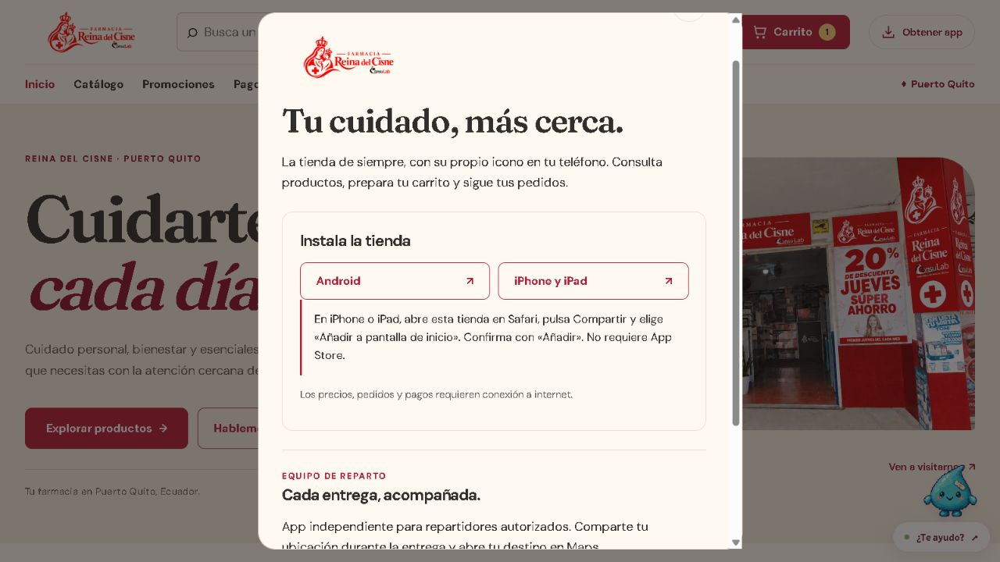
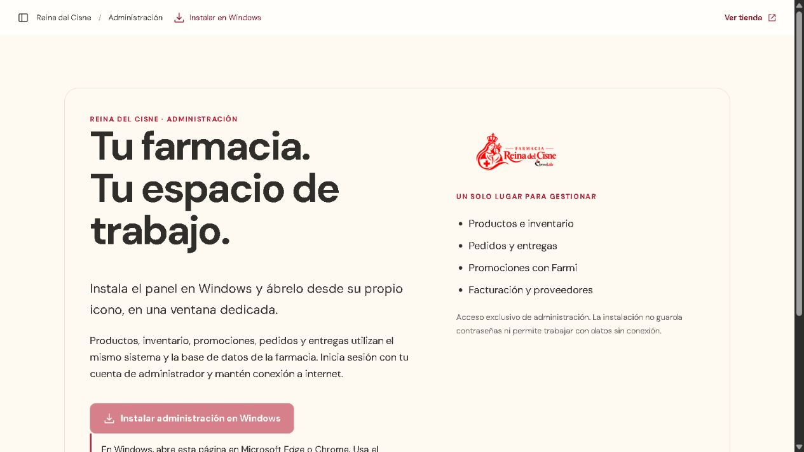
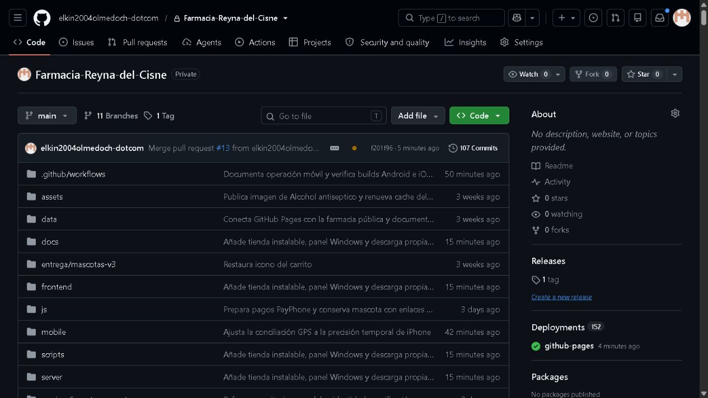
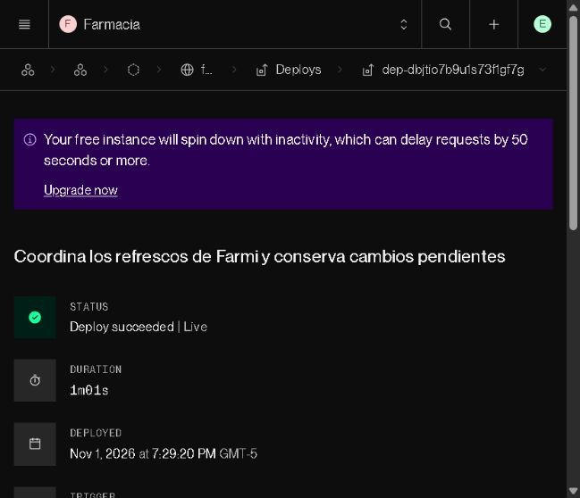

# Apps instalables y privacidad — 1 de noviembre de 2026

La tienda incorpora **Obtener app** para clientes Android/iPhone y mantiene el reparto nativo en una sección separada. Administración dispone de su propia app web instalable en Windows, con identidad y acceso distintos. Se conservan logo, colores, mascotas y arquitectura HTML/CSS/JavaScript → API Express → Prisma 6/Supabase. No se añadió un framework del Reto 3, dependencias ni cambios de esquema.

## Accesos publicados

- [Tienda: Obtener app](https://farmacia-reyna-del-cisne-pruebas.pages.dev/).
- [Instalar administración en Windows](https://farmacia-reyna-del-cisne-pruebas.pages.dev/instalar-admin): abrir en Edge/Chrome e iniciar sesión admin. Una instalación no otorga permisos; el backend sigue autorizando cada operación.
- [Reparto Android de pruebas](https://farmacia-reyna-del-cisne-pruebas.pages.dev/descargas/reparto-0.1.0.apk) y [SHA256](https://farmacia-reyna-del-cisne-pruebas.pages.dev/descargas/SHA256SUMS.txt). El archivo conserva 5.622.178 bytes y hash `537d0b0ab5f3e5f365e5df05f4b4333f9115e6a409885cde39c2a7e488180cbd`.

La instalación en iPhone/iPad de la tienda se realiza desde Compartir en Safari. No es un enlace de App Store. Para instalar, abre el navegador normal del dispositivo; incógnito y navegadores integrados pueden impedirlo. La app nativa de **reparto** para iPhone sigue pendiente de firma/aprovisionamiento; la tienda PWA no sustituye al GPS nativo. [Guía completa de instalación y límites](APPS-E-INSTALACION.md).

## Seguridad y conexión

La pantalla administrativa se verificó con una cuenta sintética existente contra la API publicada. Clientes y repartidores no habilitan ese instalador; las pruebas comprueban además el 403 del backend. No hay credenciales de base de datos ni contraseñas incorporadas al cliente. Cada app tiene su propio manifiesto/id y nombre; el modo de ventana no se presenta falsamente como prueba de que otra app ya está instalada.

El worker conserva **solo `/offline.html`**, una pantalla genérica pública. No almacena API, pedidos, documentos, ubicación ni HTML de sesión. La comprobación real sobre Cloudflare corta la conexión del contexto aislado de Chrome: la navegación muestra «Estás sin conexión» y CacheStorage solo contiene ese archivo. Se corrigió el efecto de la redirección `.html` a URL limpia: el fallback se reconstruye sin el indicador de redirección para que el navegador pueda usarlo.

Se reforzó la recuperación de confirmaciones tras errores transaccionales: solo devuelve un pedido ya guardado que coincida en usuario, clave y contenido. Los casos P2034/P2028/P1008 comprueban una venta, stock correcto, aislamiento de cuentas y rechazo de cambios de contenido. Si no hay pedido confirmado, se conserva el error de reintento y el límite de tres intentos; la prueba concurrente exige `RETRY_ORDER` exacto antes de un único reenvío manual idéntico, sin aceptar un 409 final ni aumentar plazos.

La ejecución completa detectó además dos refrescos simultáneos del resumen después de una orden de Farmi: la tarifa ya estaba guardada, pero las lecturas competían en SQLite. Farmi reutiliza ahora el coordinador existente; si había una lectura anterior a la escritura, conserva un refresco posterior y lo ejecuta al terminar. La regresión retiene un snapshot anterior al cambio y comprueba confirmación de la escritura, ausencia de lecturas paralelas y consulta posterior. No se cambió el pool, las transacciones ni el esquema para resolverlo.

La comprobación del refresco periódico de stock usa `fastForward(30000)` en lugar de reproducir cada callback intermedio de `runFor`: conserva la aserción sin otro evento de foco y el plazo global. En la comparación local de ese caso, escritorio pasó de 49,9 a 37,5 s y móvil de 45,4 a 34,0 s. Este paso prueba un refresco de datos; no necesita renderizar cada frame de las mascotas. [Semántica de Clock en Playwright](https://playwright.dev/docs/api/class-clock#clock-fast-forward).

## Fuente privada y despliegue

El repositorio quedó **PRIVATE**, verificado por metadata autenticada, etiqueta de GitHub y respuestas 404 a visitas anónimas tanto en web como en API. La tienda y la descarga propia siguen públicas. Las copias anteriores y el HTML/JavaScript entregado al navegador no se vuelven secretos por cambiar esa visibilidad.

Cloudflare conservó el acceso a este repositorio y publicó desde Git privado: frontend `1b0803d0fb7f8b24cf734cc706540ad9c52686a8`, despliegue `b55e84ed-09d2-4184-acbd-f1afcc07f40b`. El propietario aprobó explícitamente instalar la app oficial de Render limitada a esta farmacia. Se conectó el proveedor GitHub del servicio existente y Render comprobó el checkout privado; el mismo commit está confirmado Live en `dep-dbjtio7b9u1s73f1gf7g`. Sus fuentes de frontend coinciden. Los commits posteriores de documentación no cambian esos ejecutables.

Render mantiene **Free** y **Auto-Deploy Off**. No se contrató capacidad ni firma móvil. GitHub Pages histórico deja de publicarse al privatizar en Free; su workflow de despliegue se deshabilitó para evitar fallos y una publicación accidental de la raíz del repositorio. Cloudflare sigue siendo la tienda principal. No se reaplicó `render.yaml` ni se cambiaron secretos, tarifas, precios o datos comerciales.

## Evidencia de pruebas

El [CI definitivo sobre el commit publicado](https://github.com/elkin2004olmedoch-dotcom/Farmacia-Reyna-del-Cisne/actions/runs/41367361651) terminó **success**: 313/313 Node con SQLite/PostgreSQL temporales y cero omisiones, 138/138 recorridos de navegador y 22/22 Pages con orígenes separados. También aprobaron 38 pruebas históricas, 16 casos de sesión/propiedad GPS contra PostgreSQL temporal y `npm audit`.

La verificación local incluye 313/313 Node, 33 focales de instalación/distribución/recursos y 9 controles de seguridad con fallos transaccionales comprobados. La UI nueva pasó 10 recorridos en escritorio/móvil, teclado, Axe y tamaños 320–1440 px; otras 10 regresiones focales aprobaron después de corregir los refrescos. Estas cifras se solapan y no se suman como pruebas independientes. El resultado final y los fallos diagnósticos anteriores se registran en [el JSON de evidencias](pruebas/apps-2026-11-01/resultados.json).

Las verificaciones públicas comprobaron páginas, manifiestos, controladores, CSS, MIME/descarga y SHA del APK sin enviar credenciales. La comprobación administrativa utilizó la cuenta de prueba existente. No se hicieron pedidos, cobros, llamadas, facturas o ubicaciones comerciales de prueba. Las bases temporales quedaron separadas de producción y el clúster de prueba se detuvo. No se migró ni sembró la base local del propietario.

Chrome comprobó ambos manifiestos sobre la web publicada en un perfil temporal normal: identificadores y nombres distintos, cero errores de manifiesto o de instalabilidad. Esa comprobación no instala aplicaciones en el sistema operativo.

La instalación física en Android/iPhone/Windows y las pruebas de GPS de la app nativa no se sustituyen por eventos de instalación sintéticos. La PWA y su fallback real se comprobaron en navegador; el alojamiento gratuito puede suspenderse y no acredita disponibilidad 24/7.
