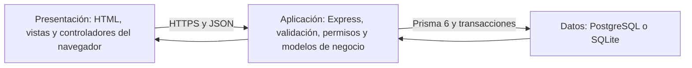

# Arquitectura comercial de la farmacia

Estado del 28 de octubre de 2026: aplicación `0d6df62` publicada en Render y Cloudflare Pages; migración aditiva aplicada en Supabase. Las 137 comprobaciones públicas aprobaron. [Evidencia comercial](pruebas/comercial-2026-10-28.json).

La aplicación amplía el MVC existente con cobertura, tarifas, reparto y seguimiento privado. Conserva HTML, CSS, JavaScript, Express 5 y Prisma 6.19.3, sin añadir un framework. La tienda histórica de la raíz y sus recursos pertenecen al antecedente estático; la aplicación con cuentas, pedidos y persistencia vive en `frontend/` y `server/`. `scripts/build-frontend.cjs` genera las pantallas y los elementos compartidos: los cambios persistentes de estructura deben realizarse en sus plantillas.

## Tres capas y MVC

| Capa | Responsabilidad y ubicación |
|---|---|
| Presentación | `frontend/controllers/` conecta eventos, modelos y vistas; `frontend/models/` maneja Fetch y estado; `frontend/views/` representa datos con controles reutilizables. El cliente presenta cotizaciones, nunca decide el precio persistido ni recibe credenciales de la base. |
| Aplicación | `server/routes/` aplica autenticación, rol y validación; `controllers/` adapta HTTP; `models/` calcula descuentos/IVA, reserva lotes y coordina estados y transacciones. `app.cjs` compone API, CORS y contenido público. |
| Persistencia | `server/models/db.cjs` reutiliza PrismaClient. `prisma-client.cjs` selecciona el cliente generado según `DATABASE_URL`: PostgreSQL para URL `postgres:`/`postgresql:`, SQLite para desarrollo local. Ambos esquemas y sus migraciones son fuentes independientes que deben mantenerse compatibles. |

La arquitectura no obliga a hospedar ambas capas HTTP en el mismo proveedor. La configuración real de los servicios existentes y el origen de API se documentan en las guías de despliegue; esta candidata no cambia por sí sola esos servicios. El navegador llama a Express, no a tablas Supabase. Las nuevas tablas PostgreSQL habilitan RLS y revocan acceso a `PUBLIC`, `anon` y `authenticated`; eso complementa la autorización JWT del backend y debe verificarse en el destino al aplicar la migración.

## Las 18 entidades

Los dos esquemas declaran las mismas 18 entidades. Las tres últimas incorporan el reparto sin duplicar clientes, productos ni inventario.

| Entidad | Finalidad |
|---|---|
| `Producto` | Catálogo, precio final, descuento, IVA y fundamento, ficha sanitaria, PVP, existencias y clasificación. Añade indicadores reales de controlado, biológico y cadena de frío. |
| `Usuario` | Cuenta y contraseña con hash, rol, actividad y versión de tokens. Se reutiliza para repartidores; el registro público conserva rol cliente (`user`). |
| `Pedido` | Compra y destinatario histórico; total, subtotal de productos, envío e IVA congelados; zona y punto de destino optativo. |
| `PedidoDetalle` | Nombre, cantidad, precio original/final, descuento e IVA históricos por producto. |
| `PedidoEstado` | Historial de transiciones del pedido con actor y fecha. |
| `Promocion` | Campaña publicada o en vista previa, producto, descuento, vigencia y recursos opcionales. |
| `Semilla` | Marcador técnico para no resembrar el catálogo inicial ni recuperar promociones eliminadas. |
| `ConfiguracionFiscal` | Tarifa general por inicio de vigencia y referencia normativa. |
| `Proveedor` | Datos reales de abastecimiento y estado activo. |
| `Lote` | Número, producto, caducidad, stock, costo y proveedor; permite priorizar vencimientos. |
| `MovimientoInventario` | Entradas, salidas, ventas y devoluciones justificadas, con actor y referencias. |
| `PedidoDetalleLote` | Cantidades de cada detalle reservadas en cada lote. |
| `ConfiguracionEmisor` | Datos del emisor SRI y certificado cifrado; información privada del servidor. |
| `SecuenciaFactura` | Numeración por emisor, ambiente, establecimiento y punto de emisión. |
| `FacturaPedido` | Snapshot fiscal, estado, clave, XML y respuestas de recepción/autorización del pedido. |
| `ZonaEntrega` — nueva | Cobertura administrable y tarifa vigente. Un importe nullable permite mantener una zona visible con costo todavía pendiente. |
| `ZonaEntregaTarifa` — nueva | Cada versión de tarifa, clasificación fiscal, fundamento, actor y fecha; permite reconstruir cambios sin sobrescribir el historial. |
| `Entrega` — nueva | Una entrega por pedido; asignación a un usuario repartidor, estados/fechas, versiones y última ubicación temporal. Evita crear historial permanente de recorridos. |

Las claves foráneas y las restricciones de las migraciones protegen relaciones, estados, rangos y consistencia fiscal. `Entrega.pedidoId` es único; los índices repartidor/estado y estado/fecha sirven a las bandejas, `recibidaAt` a la purga y zona/versión al historial de tarifas. La migración `202610280007_delivery` añade tablas, campos y controles sin borrar registros. SQLite usa triggers para parte de la consistencia del pedido; PostgreSQL usa un `CHECK`. No se intercambian esos SQL entre motores.

## Importes, versiones y transacciones

La zona inicial es **Todo Puerto Quito**, provincia Pichincha, cantón Puerto Quito, con tarifa `null`. No activa pueblos aledaños ni promete un plazo. `null` impide confirmar nuevos pedidos a domicilio; `0` expresa gratuidad deliberada. Administración puede editar la tarifa final y su clasificación: `general` usa la configuración fiscal vigente; `cero` exige fundamento registrado. El tratamiento tributario real del servicio debe confirmarse con el negocio y su asesoría; el selector no acredita una exención.

El pedido nuevo calcula productos y envío en backend y guarda los snapshots de precios, descuentos, bases e IVA. `subtotalProductos + costoEnvioCentavos/100 = total`; el precio ya incluye IVA y no lo suma dos veces. Cambiar producto, campaña o tarifa afecta compras futuras. La factura reutiliza esos importes y añade la línea de servicio `SERV-ENVIO`, sin tratarla como stock. Un borrador no es autorización SRI; véase [la guía de facturación](SRI-FACTURACION.md).

| Versión enviada | Conflicto que evita |
|---|---|
| `esperadoUpdatedAt` | Una edición antigua de producto o estado de pedido sobre cambios posteriores. |
| `esperadoTarifaVersion` | Confirmar domicilio con un costo que cambió desde la cotización. Se toma de `ZonaEntrega.version`; la comprobación precede a la reserva de inventario. |
| `esperadoVersion` | Sobrescribir una zona o reasignar/avanzar una entrega con una versión logística anterior. |
| `esperadoGpsVersion` | Reintroducir una muestra GPS tras una retirada o una actualización concurrente. No cambia la versión logística. |

Los pedidos conservan clave UUID de idempotencia y huella: repetir la misma compra devuelve la existente, incluso si después cambió la tarifa; usar la misma clave con otros datos devuelve conflicto. Las transacciones serializables y los reintentos acotados protegen reserva/devolución y estados. Entregar/cancelar sincroniza pedido, entrega, historial y retirada de coordenadas en la misma transacción. Cancelar conserva las restricciones fiscales y la devolución única a lotes. Avanzar el reparto vuelve a comprobar la caducidad de los lotes.

## API y límites por rol

Las rutas tienen prefijo `/api`. Las respuestas satisfactorias usan `{ok:true,data:...}`. La API responde con `Cache-Control: no-store`; los recursos privados exigen Bearer JWT, actividad y permisos. CORS admite solo los orígenes configurados. El cliente no puede concederse un rol operativo.

| Módulo | Contrato principal y acceso |
|---|---|
| Catálogo/campañas/fiscalidad pública | Lecturas de `/productos`, `/promociones` y `/configuracion/fiscal`; modificaciones de catálogo/campañas reservadas a admin. |
| Cuentas | Registro/login y sesión propios; límites de intentos existentes. Crear repartidores requiere admin por una ruta específica. |
| Compras | Cliente o admin crea `/pedidos` y consulta `/pedidos/mis-pedidos`; admin consulta la bandeja general y cambia estados con versión. Repartidor no compra ni accede a ese módulo. |
| Inventario/proveedores/fiscal/SRI | Rutas administrativas existentes con validaciones específicas. La consulta de factura del cliente conserva control de propiedad. |
| Cobertura/reparto | Zonas públicas; gestión de tarifas y repartidores solo admin; reparto admin o repartidor asignado; seguimiento cliente propietario o admin. [Contrato operativo y endpoints](ENTREGAS-Y-PRIVACIDAD.md#contrato-de-la-api-de-entregas). |

Un recurso de otro comprador o repartidor devuelve 404. El DTO operativo de entrega activa incluye solo nombre/teléfono/destino necesarios; excluye email, identificación, medicamentos e importes. Al cerrar devuelve `destino:null`. El seguimiento del comprador devuelve estados/fechas y ubicación reciente, sin datos personales del repartidor. La autorización se comprueba en backend aunque alguien abra una pantalla o construya una petición manualmente.

## Farmi y comandos administrativos

`frontend/controllers/admin-command.mjs` interpreta una gramática local cerrada; `admin-companion.js` ejecuta acciones tipadas a través de los mismos modelos y endpoints que los formularios. Requiere sesión admin y procesa una orden por vez. Los mensajes se muestran como texto. No utiliza IA externa, SQL, `eval`, shell ni un despachador genérico de métodos.

| Orden disponible | Comportamiento |
|---|---|
| `ayuda`, `abre proveedores`, `abre entregas`, `abre formulario de producto` | Muestra formatos, navega o abre un editor. La navegación no carga todo el catálogo. |
| `actualiza el precio de "NOMBRE EXACTO" a 13,50 y el stock a 24` | Cambia campos admitidos de un producto inequívoco. Las cifras son sintaxis de ejemplo, no precios comerciales recomendados. |
| `modifica producto "NOMBRE EXACTO": descripcion="Texto real"` | Actualización estructurada de campos permitidos y versión vigente. |
| `desactiva producto "NOMBRE EXACTO"` | Desactiva sin borrar su historial. |
| `publica promoción de 20 % para "NOMBRE EXACTO" hasta 2026-12-31 titulada "Título"` | Crea/publica con porcentaje y fecha final explícitos en hora de Ecuador; conserva límites y exclusiones sanitarias. |
| `crea producto: ...`, `crea proveedor: ...`, `registra lote: ...`, `ajusta inventario: ...` | Campos `campo=valor` separados por `;`; nombres exactos de producto para lote/ajuste. `ayuda` enumera campos. Faltantes abren el formulario o solicitan detalle. |
| `cambia pedido "ID" a preparado` | Consulta la versión y solicita la transición permitida; también reconoce confirmado, entregado y cancelado. |
| `modifica zona "puerto-quito": tarifaCentavos=null` | Mantiene la tarifa pendiente; un entero real acordado configura el importe en centavos. También permite crear zonas con todos los campos requeridos. |
| `asigna pedido "ID" a repartidor "ID"`, `cambia entrega "ID" a en_destino` | Usa identificadores reales y versión actual. La API valida asignación y transición; reconoce en_camino, en_destino, entregada y cancelada. |

No hay edición libre de proveedores/lotes por chat ni creación de usuarios/roles, carga de credenciales, firmas, cobros o emisión fiscal automática. Para información privada o decisiones fiscales se utilizan los controles específicos. No escribas contraseñas, certificados o secretos en el chat. Una orden no inventa registros sanitarios, direcciones, RUC, tarifas ni permisos. Errores, nombres ambiguos y conflictos deben resolverse con datos actuales, no repitiendo el guardado ciegamente.

## Operación y verificación

El [manual de entregas y privacidad](ENTREGAS-Y-PRIVACIDAD.md) explica configuración, compra, asignación, navegación, teclado, errores y retirada de ubicación. Los [criterios de Ecuador](ECUADOR-FARMACIA.md) separan controles técnicos de obligaciones que requieren validación del negocio.

En la validación local del 28 de octubre de 2026 pasaron 242 pruebas Node sin omisiones, incluidas las de PostgreSQL temporal real; 38 pruebas de la tienda histórica; 20 escenarios de Pages entre orígenes y 92 del agente .NET. Ambos schemas se validaron con Prisma 6.19.3 y `npm audit` informó cero vulnerabilidades. Todos los datos escritos por estas suites son sintéticos y pertenecen a bases temporales.

En el cierre de la ampliación inicial, la suite completa de navegador aprobó 73 de 74 casos. El fallo restante estaba en un helper de la propia prueba: solo avanzaba páginas para buscar un pedido nuevo situado en una página anterior. La regresión se reprodujo con 41 pedidos sintéticos; tras reutilizar el buscador bidireccional pasaron los dos perfiles. Quedan cubiertos los 74 casos entre suite y repetición focal. No se modificó la aplicación después de esa suite ni se presenta una tercera ejecución completa inexistente. Los cuatro fallos de fixtures de Quito/tarifa implícita en la primera ejecución también quedaron corregidos y aprobados.

Supabase recibió únicamente la migración aditiva `202610280007_delivery`, después de respaldar base/Storage y comprobar sus hashes. Las 15 tablas anteriores conservan conteos y hashes de todas sus columnas previas: 18 productos, dos usuarios y un pedido. Las tres tablas nuevas tienen RLS y deniegan acceso directo anon/authenticated. La zona Puerto Quito mantiene tarifa pendiente, un registro de historial y cero entregas; no se inventaron repartidores ni pedidos reales. Render quedó Live en `dep-dbhbilm7bikc73e5vkdg` y Cloudflare confirmó éxito del despliegue `565901d4-b133-4468-bd5e-d0d410916ba3`; los archivos públicos coinciden con el artefacto local y las barreras anónimas aprobaron. La verificación pública no utilizó cuentas válidas ni creó pedidos reales. Las suites no emiten facturas reales, correos ni órdenes comerciales.

La revisión posterior de recorridos aprobó la suite completa de navegador (82/82), Node (242/242), históricas (38/38) y Pages (20/20), sin omisiones. Dos ensayos adicionales cargaron OpenStreetMap real con GPS sintético; 28 capturas documentan la demostración y el carrito publicado. Corrige el refresco administrativo y la provincia canónica, e incorpora barra inferior y códigos de Farmi con foco conservado. El código `0d6df62` está Live en Render y publicado en Pages: aprobaron 137 comprobaciones públicas y dos recorridos anónimos. [Recorrido y límites](RECORRIDO-ROLES-2026-10-28.md), [evidencia exacta](pruebas/recorrido-roles-2026-10-28.json).
