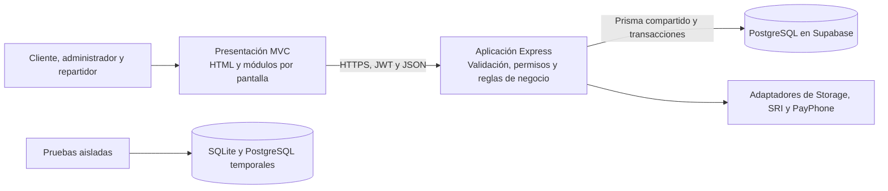
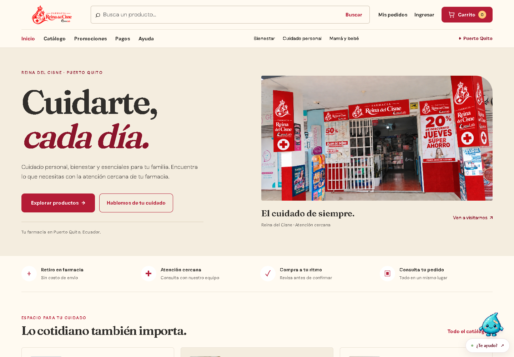

# Arquitectura, identidad y pruebas — 29 de octubre de 2026

La farmacia conserva HTML, CSS, JavaScript, Express 5 y Prisma 6.19.3. La dirección visual elegida por el propietario es una experiencia elegante de cuidado personal, con el vino, el crema, el logo y las mascotas existentes.

## Arquitectura que se implementa

Los módulos de negocio se mantienen dentro del mismo backend. La API decide el precio, stock vendible, permisos y cambios de estado; el navegador representa esos resultados. El frontend desplegado en Cloudflare Pages y la API en Render conservan su separación. La tienda histórica de la raíz, publicada por GitHub Pages, es otro destino y no sustituye la aplicación comercial.

| Cambio | Resultado verificable |
|---|---|
| Importaciones por pantalla | La portada descarga 17 módulos MVC en lugar de 41; no carga administración, facturación, pagos o reparto. La sesión lenta conserva los productos visibles y mantiene ocultas las acciones de compra mientras el rol sea incierto. |
| Preparación de pantallas | Un `fieldset` nativo deshabilita los controles hasta instalar su controlador, conservando los bloqueos propios de cada campo. `inert` impide interacción anticipada; los errores recuperables del dashboard conservan navegación y reintento por teclado. Las pantallas estáticas de inicio y ayuda permanecen disponibles. |
| Precios públicos | Catálogo, detalle y campañas consultan únicamente stock y vencimiento de los lotes vencidos con saldo. Las reservas mantienen la información completa y sus transacciones. |
| Paginación | Productos, pedidos y proveedores usan el identificador como desempate cuando coincide fecha o nombre. El conjunto estable tiene un orden definido. No es una paginación de snapshot ante inserciones concurrentes. |
| Salud | `/api/salud` conserva su contrato y comprueba la base. Tiene presupuesto independiente de 60 consultas por minuto e IP; una base indisponible responde 503 sin exponer el error interno. |
| Ciclo de vida | Los fallos de escucha se controlan; las señales comparten una sola limpieza. El cierre espera el respaldo SQLite que todavía esté iniciándose, desconecta Prisma y tiene un plazo total de 25 segundos. |
| Plantilla propia | La portada MVC se genera desde `scripts/templates/home.cjs`, sin extraer ni transformar el HTML histórico. Se conservan las anclas y el formulario de contacto. |
| Identidad | Tipografía editorial, fotografía real, selección antes de promociones, contenido de hasta 1320 px y contacto unificado. La cabecera móvil pasa de 241 a 168 px, con controles principales de 44 px. |
| Mascota | La animación descarga su atlas; la imagen estática se solicita si falta, falla o tarda más de tres segundos. Se probaron el fallo del manifiesto, el fallo de imagen y la recuperación después de una carga lenta. |
| Dependencia .NET | MailKit 4.18.2 actualiza MimeKit y evita la versión vulnerable de `System.Security.Cryptography.Pkcs`; no se añadió otro paquete directo. |

## Mediciones locales

Se utilizó la misma suite, SQLite temporal, Chrome instalado, caché desactivada, escritorio 1440×1000 y tres muestras por perfil. El perfil limitado simula 10 Mbps de descarga, 5 Mbps de subida y 40 ms de latencia. Las cifras no son producción ni una prueba de capacidad máxima.

| Indicador de portada | Antes | Después |
|---|---:|---:|
| Peticiones de recursos | 71 | 46 |
| Transferencia observada | 5.615.040 B | 4.747.376 B |
| Módulos MVC | 41 | 17 |
| Transferencia de módulos MVC | 266.911 B | 78.608 B |
| FCP, mediana del perfil limitado | 660 ms | 636 ms |
| LCP, mediana del perfil limitado | 1536 ms | 1616 ms |

La reducción observada es de 35,2 % en peticiones y 15,5 % en transferencia. **No se acredita una mejora sostenida del pintado**: FCP bajó ligeramente y LCP aumentó en esta ejecución; otras muestras variaron. No se presentan como tiempos de producción ni se descarta el aumento de LCP como ruido sin otra comprobación. Se conservan las mediciones intermedias y una comparación alternada adicional de seis navegaciones con `measure-pages.cjs`; esa comparación también cambia el origen de publicación y no permite atribuir causalidad a una sola modificación.

En otro experimento local, un producto con 2000 lotes futuros agotados, uno vigente y uno vencido pasó de recuperar **2002 a 1 filas de lote**, de **513.400 a 40 B** internos y de mediana **61,89 a 6,88 ms** en cinco pares tras calentamiento. El DTO, el stock vendible y el precio fueron iguales. Es una medición de consulta/modelo local, no p95 ni una promesa de respuesta de la API pública.

## Pruebas y evidencia

Las cinco suites terminaron con **550 pruebas aprobadas, sin fallos, omisiones ni casos flaky**. Los servicios externos no activados se sustituyen por respuestas de prueba, como se precisa más abajo.

| Suite | Resultado final | Entorno |
|---|---:|---|
| Node: API, permisos, inventario, fiscalidad, pagos y lifecycle | 270/270 | SQLite y PostgreSQL reales temporales |
| Tienda histórica | 38/38 | Estado y archivos sintéticos/locales |
| Navegador MVC | 128/128 | Chrome, escritorio y móvil; Node 22.23.4 |
| Frontend/API entre orígenes | 22/22 | Artefacto de Pages y API local separada |
| Agente de inventario .NET | 92/92 | Incluye 16 casos PostgreSQL, transportes simulados |

Ambos esquemas Prisma 6 validan. Los 22 archivos JavaScript/CJS/MJS modificados pasan sintaxis. Las auditorías npm y NuGet, incluidas las dependencias transitivas, informaron cero vulnerabilidades conocidas. La dependencia MailKit se actualizó de 4.17.0 a 4.18.2; las versiones y fuentes están en la evidencia.

La misma revisión `aa4ecb7` aprobó en Linux/Node 22 la [verificación MVC de GitHub](https://github.com/elkin2004olmedoch-dotcom/Farmacia-Reyna-del-Cisne/actions/runs/40987555145) y las [92 pruebas .NET](https://github.com/elkin2004olmedoch-dotcom/Farmacia-Reyna-del-Cisne/actions/runs/40987555144). El [workflow reproducible](../.github/workflows/verify-mvc.yml) ejecuta los comandos y prepara PostgreSQL aislado, sin secretos comerciales. Publicar un resultado no activa servicios de pago ni notificaciones.

Después de integrar, [CI repitió en `main` para `f2ab405`](https://github.com/elkin2004olmedoch-dotcom/Farmacia-Reyna-del-Cisne/actions/runs/40988490530) y volvió a aprobar 270 Node, 38 históricas, 128 de navegador y 22 Pages. [El agente .NET de esa misma revisión](https://github.com/elkin2004olmedoch-dotcom/Farmacia-Reyna-del-Cisne/actions/runs/40988490459) también aprobó.

[Evidencia estructurada y mediciones](pruebas/arquitectura-2026-10-29.json). La ejecución local usa configuración saneada, sin cargar los archivos `.env` privados. Los puertos de prueba 3300, 3301, 3302 y 54621 quedaron libres; se detuvo el clúster temporal sin modificar el servicio PostgreSQL del equipo.

La base anterior aprobó 38 pruebas históricas, 252 Node y 6 de PostgreSQL real temporal; Node había omitido la suite PostgreSQL antes de activar ese entorno. Pages aprobó 22 casos. La suite inicial de navegador terminó 113/114: el caso de facturación móvil asumía que el pedido nuevo estaba en la primera página administrativa. La corrección crea 21 pedidos sintéticos, elige uno que necesariamente queda fuera de la primera página y recorre el paginador. Falló en ambos perfiles antes de corregir la búsqueda y pasó después.

Durante la integración, la primera suite Node terminó 269/270 porque un fixture VM no conocía el nuevo módulo lifecycle; se corrigió el fixture y se repitió con 270 aprobadas. Pages detectó el clic anterior a cargar el controlador; una primera barrera basada solo en `inert` tampoco hacía esperar al `fill` de la automatización. El `fieldset` nativo corrige el estado editable y las 22 pruebas posteriores aprobaron. La revisión independiente detectó y corrigió además el reintento del dashboard ante 503.

Otra ejecución de navegador terminó 126/128: un worker nativo de Windows salió con código 3221226505 antes de iniciar un caso PayPhone y un helper de promociones leyó la tabla durante su carga. El caso PayPhone pasó aislado y en móvil; el helper recibió una espera de estado y una regresión con respuesta retenida. La repetición completa con Node 22 aprobó 128/128; la ejecución independiente de GitHub también aprobó los 128. Un primer workflow inválido usaba un contexto de GitHub no disponible en `job.env`; se corrigió antes de obtener los resultados remotos citados.

Las pruebas automáticas de accesibilidad se complementan con comprobación de teclado, anclas, longitudes y seis anchos entre 320 y 1920 px. Cero infracciones automáticas en las vistas inspeccionadas no certifica toda la accesibilidad de la aplicación.

## Publicación y recorrido visible

[Abrir la tienda comercial actualizada](https://farmacia-reyna-del-cisne-pruebas.pages.dev/).

El [PR #11](https://github.com/elkin2004olmedoch-dotcom/Farmacia-Reyna-del-Cisne/pull/11) quedó integrado en `main`, revisión `f2ab405`. Se comprobó que su árbol es idéntico al de la revisión validada `aa4ecb7`. Render confirmó Live en `dep-dbhvhvec6qcc73f3k4hg` para esa revisión y Cloudflare publica el artefacto de la misma fuente desde `codex/separacion-cloudflare`.

Las **151 comprobaciones públicas aprobaron**, sin reintentos de transporte: las 12 pantallas de Render, los 107 archivos del artefacto de Pages, CSP y Storage, catálogo y cobertura, CORS, límites anónimos y rutas privadas. El catálogo conserva sus 18 referencias y la cobertura pública coincide con la observada antes del despliegue. La arquitectura de esta revisión no modifica esquemas ni realiza una migración de datos comerciales.

En cuatro perfiles de navegador públicos se comprobaron portada/carrito/acceso y pagos de demostración en escritorio/móvil. El carrito muestra la miniatura y la barra inferior; el cliente anónimo llega al acceso antes de confirmar. La mascota se dibuja y responde. La demostración aprueba, rechaza y cancela sin cuentas ni cobros. No hubo escrituras comerciales ni errores inesperados de JavaScript; las comprobaciones de pago también registraron cero errores HTTP, de consola y solicitudes fallidas.

| Vista publicada | Captura |
|---|---|
| Portada de escritorio | [Ver portada](pruebas/arquitectura-2026-10-29/publicado-portada-escritorio.png) |
| Portada móvil | [Ver portada móvil](pruebas/arquitectura-2026-10-29/publicado-portada-movil.png) |
| Pago de demostración en escritorio | [Ver pagos](pruebas/arquitectura-2026-10-29/publicado-pagos-escritorio.png) |
| Pago de demostración móvil | [Ver pagos móvil](pruebas/arquitectura-2026-10-29/publicado-pagos-movil.png) |

Las siguientes capturas pertenecen al recorrido aprobado en la base temporal. Los nombres, importes, pedidos y posiciones son sintéticos; el mapa lleva una etiqueta de prueba y no muestra una entrega real.

| Rol | Evidencia |
|---|---|
| Administrador: Farmi cambia precio y publica promoción | [Ver Farmi](pruebas/arquitectura-2026-10-29/administrador-farmi.png) |
| Administrador: cobertura, tarifa y repartidor | [Ver entregas](pruebas/arquitectura-2026-10-29/administrador-entregas.png) |
| Repartidor: destino, Maps y llamada al llegar | [Ver destino](pruebas/arquitectura-2026-10-29/repartidor-destino.png) |
| Cliente: seguimiento privado y mapa voluntario | [Ver seguimiento](pruebas/arquitectura-2026-10-29/cliente-seguimiento.png) |

Los hashes, captions y alcances están en los manifiestos y la evidencia JSON de esta carpeta. No se llamaron clientes ni se enviaron mensajes desde estas pruebas.

## Crecimiento y operación

- El primer crecimiento conserva los módulos actuales: recursos estáticos en CDN, imágenes comerciales en Storage, API con un cliente Prisma por proceso y consultas/páginas acotadas. Las reglas de negocio y las referencias monetarias permanecen en el servidor.
- El catálogo, comparador y algunos selectores todavía reúnen páginas mediante `catalog.all()`. Con un catálogo grande se debe medir esa carga y trasladar búsqueda, orden y navegación al servidor antes de prometer ese volumen. La API paginada ya existe; esta revisión no presenta el navegador como una interfaz virtualizada ni una prueba de carga masiva.
- Antes de añadir réplicas de API, dimensionar conexiones con el pool de Supabase y el número de procesos; medir consultas, esperas, CPU, memoria y percentiles bajo un volumen acordado. Los limitadores actuales usan memoria por proceso: una cuota global entre réplicas requiere un almacén compartido antes de habilitar esa topología. No se ha instalado ni probado esa infraestructura.
- Mantener PostgreSQL y Storage con respaldo externo verificado; SQLite sigue siendo una opción de desarrollo/local y sus respaldos no protegen Supabase. Los datos críticos no deben depender del disco efímero del servicio HTTP.
- Render Free puede detener una instancia y producir arranques en frío. Antes de cobros reales, garantizar disponibilidad, plazo del proveedor, conciliación y procedimiento de recuperación. No se cambiaron planes ni se asumió una capacidad comercial certificada.
- Un cierre forzado o una conexión interrumpida puede dejar una operación con resultado incierto. Las escrituras de negocio no se repiten ciegamente; conservar idempotencia y conciliar pagos antes de devolver existencias.

La tarifa de entrega sigue bajo control de administración y un importe pendiente no es gratuito. PayPhone permanece desactivado, sin cuenta comercial del propietario; las pruebas de pagos usan respuestas simuladas. SRI, mensajes de proveedores y cobros no se ejecutan comercialmente durante estas pruebas. El mapa de reparto se prueba con coordenadas sintéticas y enlaces a los proveedores; la navegación física y el GPS del teléfono dependen del dispositivo.

Referencias de la corrección .NET: [MailKit 4.18.2](https://api.nuget.org/v3-flatcontainer/mailkit/4.18.2/mailkit.nuspec), [MimeKit 4.18.2](https://api.nuget.org/v3-flatcontainer/mimekit/4.18.2/mimekit.nuspec), avisos oficiales [GHSA-846f-f764-76mx](https://github.com/dotnet/runtime/security/advisories/GHSA-846f-f764-76mx) y [GHSA-2fmv-rv2c-59x7](https://github.com/dotnet/runtime/security/advisories/GHSA-2fmv-rv2c-59x7).
