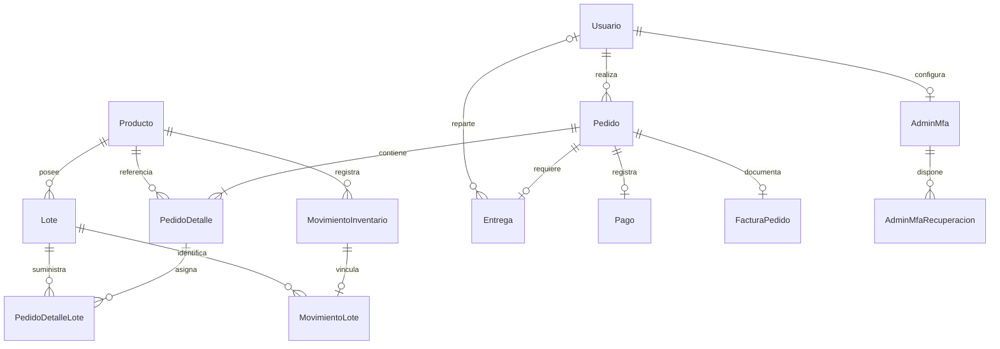

# Defensa del proyecto integrado

Preparación del 23 de noviembre de 2026 para presentar los retos 1 y 2 juntos. La aplicación utiliza HTML, CSS y JavaScript, Express y Prisma 6.19.3. PostgreSQL en Supabase es la base publicada; SQLite conserva la ejecución local reproducible. El título y objetivo del enunciado permiten otro motor relacional. Su frase interna sobre SQL Server se explica declarando esta elección.

## Recorrido recomendado

1. **Cliente.** Abrir la tienda, buscar un producto con precio y stock, consultar su ficha y añadirlo. Mostrar imagen, cantidades y total del carrito; recargar para demostrar persistencia. Las referencias «Consultar precio y disponibilidad» requieren completar sus datos comerciales antes de venderse.
2. **Cuenta.** Iniciar sesión. Una cuenta nueva verifica su correo cuando el proveedor está habilitado. La pestaña de registro detecta la confirmación y permite continuar. El perfil guarda nombre y teléfono; direcciones y favoritos pertenecen a la cuenta.
3. **Compra.** Revisar entrega o retiro, tarifa y total. El servidor vuelve a calcular existencias e impuestos. El modo de práctica registra pedido, detalles y resultado del pago juntos, sin cobrar dinero. Un pago comercial requiere confirmación de la pasarela. El comprobante imprimible conserva su aviso de validez tributaria.
4. **Administrador.** Entrar con el identificador breve entregado por el titular. Crear, editar y dar de baja un producto de evaluación en una instalación local. Mostrar que su cambio se refleja en el catálogo y que una versión antigua recibe un conflicto recuperable.
5. **Configuración y datos.** Seleccionar Productos, Usuarios, Pedidos y Detalles; después otra de las 34 tablas. Mostrar paginación y enlace a su gestión. Crear un usuario, editar su rol con confirmación y explicar que se revocan sus sesiones. El último administrador activo está protegido.
6. **Goti.** Escribir «actualizar productos» o «poner en promoción», seleccionar un producto y revisar la propuesta. «No, cancelar» conserva el registro; «Sí, confirmar» usa la misma API autorizada que el formulario. En la tienda, buscar y confirmar agregar al carrito.
7. **Repartidor.** Abrir Entregas con su cuenta. Mostrar pedido asignado, ruta integrada, inicio, llegada y código del comprador para entregar. El navegador solicita permiso GPS; la ruta depende de ubicación y red disponibles. Con un solo repartidor activo, la asignación es automática conforme al estado del pedido.

Los cambios de evaluación se hacen en una copia local con datos sintéticos. La publicación conserva pedidos y existencias comerciales. Las pruebas de mapa automatizadas controlan GPS y respuestas del proveedor para repetir el recorrido; no acreditan seguimiento físico con el teléfono bloqueado.

## Evidencia de requisitos

| Requisito | Implementación | Comprobación reproducible |
| --- | --- | --- |
| MVC en frontend | models consume API y administran estado; views renderizan; controllers coordinan eventos | tests/reto2/frontend.spec.cjs y admin-data.spec.cjs |
| MVC en backend | routes → middleware → controllers → models → Prisma | server/routes/index.cjs y tests/reto2/api.test.cjs |
| Persistencia relacional | Usuario, Producto, Pedido y PedidoDetalle con claves y restricciones, más entidades operativas | ambos esquemas y tests/reto2/normalization-migration.test.cjs |
| CRUD seguro | GET público y POST/PUT/PATCH/DELETE de producto con rol admin; baja lógica | tests/reto2/api.test.cjs y product-patch.test.cjs |
| JWT y roles | login por usuario o correo, token firmado, expiración, revocación y autorización en servidor | admin-access.test.cjs y security-controls.test.cjs |
| CORS, hash y validación | orígenes exactos, bcrypt12, campos permitidos, Prisma y errores consistentes | cross-origin.test.cjs y production.test.cjs |
| Catálogo y carrito | Fetch async/await, estado persistente, recálculo de disponibilidad | frontend.spec.cjs, catalog y cart tests |
| Compra real en SQL | transacción de pedido, detalles, reserva/descuento de stock e idempotencia | api.test.cjs y pruebas de pedidos/pagos |
| Admin de todas las tablas | recursos registrados, lectura paginada y columnas autorizadas | admin-resources.test.cjs y postgres-admin.test.cjs |
| Usuarios y cambios en navegador | formularios, control de versión, roles, cierre de sesiones y último admin | admin-users.test.cjs y admin-data.spec.cjs |
| Accesibilidad | labels, foco, teclado, mensajes y modales accesibles, escritorio y móvil | suite Playwright y Axe |
| Normalización | códigos MFA en filas y vínculo de inventario separado; conservación histórica | NORMALIZACION.md y postgres-normalization.test.cjs |
| OWASP documentado | acceso, criptografía, inyección/XSS con mitigaciones concretas | sección de seguridad del README |
| Entrega completa | único ZIP, .env.example, código, migraciones, pruebas y documentación | scripts/crear-reto2.ps1 y package-security.test.cjs |

## Patrones presentes y finalidad

| Patrón o práctica | Ejemplo real | Finalidad |
| --- | --- | --- |
| MVC | frontend/models, views, controllers y server/routes, controllers, models | Separar representación, interacción y acceso a datos. |
| Acceso a datos mediante módulos de repositorio | server/models/productos.cjs e inventario.cjs | Concentrar consultas y reglas transaccionales fuera del controlador HTTP. |
| Observer mediante eventos | cambios del carrito notifican a sus vistas; actualización del catálogo mediante eventos compartidos | Mantener vistas sincronizadas sin duplicar estado. |
| Instancia compartida por módulo | server/models/db.cjs reutiliza PrismaClient | Evitar una conexión nueva por petición y cerrar recursos al terminar. |
| Cadena de middleware | autenticación, roles, validación y error centralizado en las rutas | Componer controles comunes y mantener respuestas coherentes. |
| Inyección de dependencias | createApp(settings), transporte de correo y funciones de ejecución de setup | Probar errores y escenarios sin enviar correos ni modificar producción. |

MVC es el patrón arquitectónico principal. Estas prácticas se justifican por el código que existe; no se atribuyen patrones GoF que no se han implementado.

## Modelo relacional principal

Las claves y dependencias del resto de tablas se explican en [Normalización](NORMALIZACION.md). Los precios, dirección e impuestos del pedido representan el momento de compra y conservan su valor aunque cambie el catálogo.

## Ejecutar y explicar pruebas

En una extracción nueva: `npm ci --include=dev`, `npm run setup`, `npm start`. El archivo privado .env contiene el acceso inicial generado; no se entrega en el ZIP. `npm test` comprueba los retos juntos. `npm run test:browser` ejecuta los recorridos de navegador. Las pruebas PostgreSQL son optativas y exigen un cluster temporal separado con su guardia de seguridad; una omisión no equivale a un aprobado.

Conviene distinguir evidencia automatizada de operación externa. Brevo necesita remitente habilitado y conectividad; PayPhone sigue pendiente de cuenta comercial; el comprobante de pedido no sustituye una factura autorizada por SRI. Render Free puede arrancar en frío. La versión web conserva el mapa integrado, sin instaladores, y requiere permisos GPS. Estos límites forman parte de la defensa técnica.
