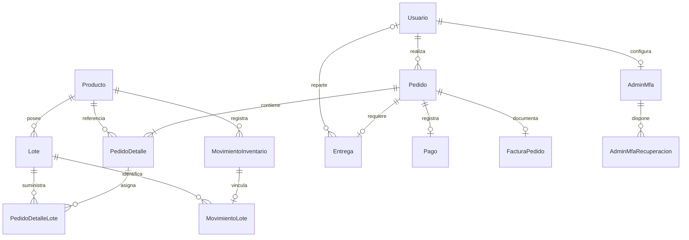

# Defensa del proyecto integrado

Preparación del 23 de noviembre de 2026 para presentar los retos 1 y 2 juntos. La aplicación utiliza HTML, CSS y JavaScript, Express y Prisma 6.19.3. PostgreSQL en Supabase es la base publicada; SQLite conserva la ejecución local reproducible. El título y objetivo del enunciado permiten otro motor relacional. Su frase interna sobre SQL Server se explica declarando esta elección.

## Para abrir en la universidad

| Minuto | Qué mostrar | Qué explicar |
| --- | --- | --- |
| 0–1 | [Catálogo](https://farmacia-reyna-del-cisne-pruebas.pages.dev/catalogo) y [ficha de Ensure Advance](https://farmacia-reyna-del-cisne-pruebas.pages.dev/producto?id=vitaminas) | «En el Reto 1 construí el catálogo y el carrito. En el Reto 2 conecté esa interfaz a una API con usuarios, inventario y pedidos persistentes». Busca Ensure, abre la ficha y añade una unidad. |
| 1–2 | Carrito y [compra](https://farmacia-reyna-del-cisne-pruebas.pages.dev/checkout) | Cambia la cantidad y recarga. La imagen, la cantidad y el subtotal se conservan. Intenta continuar sin sesión y enseña la solicitud de ingreso. |
| 2–3 | [Cuenta](https://farmacia-reyna-del-cisne-pruebas.pages.dev/cuenta) y [Mis pedidos](https://farmacia-reyna-del-cisne-pruebas.pages.dev/pedidos) | Abre la grabación de la compra para mostrar el pago de práctica y la entrega hasta «Entregado». El total se calcula en el servidor. Pedido y detalles se guardan juntos. |
| 3–5 | [Administración de productos](https://farmacia-reyna-del-cisne-pruebas.pages.dev/admin?tabla=productos) y [pedidos de los clientes](https://farmacia-reyna-del-cisne-pruebas.pages.dev/admin?tabla=pedidos) | Inicia sesión en otra ventana con tu cuenta administrativa. Muestra el formulario de producto y la lista de pedidos. Para crear, editar y dar de baja usa el ZIP con su base local. En Goti escribe «actualizar productos», selecciona uno y cancela la propuesta para mostrar la confirmación. |
| 5–6 | [Consulta completa de tablas](https://farmacia-reyna-del-cisne-pruebas.pages.dev/admin?tabla=datos&vista=completa) | Tras iniciar sesión como administrador, abre este enlace. Selecciona Productos, Pedidos y Detalles. El producto identifica qué se compró y el detalle conserva cantidad y precio pagado. La consulta completa abarca los 34 modelos con los campos autorizados. |
| 6–7 | [API del producto](https://farmacia-reyna-del-cisne-pruebas.pages.dev/api/productos/vitaminas), [salud](https://farmacia-reyna-del-cisne-pruebas.pages.dev/api/salud) y [pedidos protegidos](https://farmacia-reyna-del-cisne-pruebas.pages.dev/api/pedidos) | Abre los pedidos protegidos en una ventana privada sin sesión. En Red del navegador muestra el 401. La prueba automatizada cubre el 403 del cliente autenticado que intenta crear un producto. |

La [publicación para clase](https://github.com/elkin2004olmedoch-dotcom/Farmacia-Reyna-del-Cisne/releases/tag/defensa-reto2-2026-11-24) reúne el ZIP, el video y la evidencia de la revisión. Descarga el ZIP y el video antes de entrar al aula. Abre el enlace de salud antes de tu turno para darle tiempo al servicio gratuito de Render.

### Las siete pruebas que pide el docente

| Prueba mínima | Evidencia que puedes enseñar |
| --- | --- |
| Login admin obtiene JWT | En [pruebas de API](../tests/reto2/api.test.cjs), el primer caso inicia sesión y verifica el JWT firmado. En la exposición basta mostrar que el caso pasó, sin proyectar el token. |
| Admin crea un producto | La misma suite comprueba la respuesta 201. En [pruebas de navegador](../tests/reto2/frontend.spec.cjs), el administrador crea, edita y da de baja desde el panel. |
| Cliente no puede crear productos | El caso de rol comprueba 403 con un JWT de cliente válido. La petición sin sesión recibe 401. |
| El catálogo consume la API | La lista pública y la ficha muestran la misma referencia. En la pestaña Red filtra por `productos` y muestra una respuesta GET. |
| El carrito persiste | El caso de catálogo y persistencia recarga la página antes de comprar y verifica el contenido guardado. También puedes reproducirlo en la tienda. |
| La compra persiste en la base | El caso de pedido consulta la base con Prisma y verifica el total, la cantidad, el precio unitario y el descuento de stock. Repetir la solicitud conserva el mismo pedido. |
| El admin ve todos los pedidos | El caso de separación de usuarios prueba que otro cliente no ve el pedido y que el administrador sí accede al listado global. |

Si te preguntan por seguridad, señala un control por riesgo en el [README](../README.md#tres-riesgos-owasp-y-sus-mitigaciones). Para preguntas sobre tablas, abre la [normalización](NORMALIZACION.md). Las [diez auditorías](AUDITORIAS-Y-DEFENSA-GOTI.md) tienen el caso, el resultado documentado y su alcance.

## Recorrido recomendado

1. **Cliente.** Abrir la tienda, buscar un producto con precio y stock, consultar su ficha y añadirlo. Mostrar imagen, cantidades y total del carrito; recargar para demostrar persistencia. Las referencias «Consultar precio y disponibilidad» requieren completar sus datos comerciales antes de venderse.
2. **Cuenta.** Iniciar sesión. Una cuenta nueva verifica su correo cuando el proveedor está habilitado. La pestaña de registro detecta la confirmación y permite continuar. El perfil guarda nombre y teléfono; direcciones y favoritos pertenecen a la cuenta.
3. **Compra.** Revisar entrega o retiro, tarifa y total. El servidor vuelve a calcular existencias e impuestos. El modo de práctica registra pedido, detalles y resultado del pago juntos, sin cobrar dinero. Un pago comercial requiere confirmación de la pasarela. El comprobante imprimible conserva su aviso de validez tributaria.
4. **Administrador.** Entrar con el identificador breve entregado por el titular. Crear, editar y dar de baja un producto de evaluación en una instalación local. Mostrar que su cambio se refleja en el catálogo y que una versión antigua recibe un conflicto recuperable.
5. **Configuración y datos.** Seleccionar Productos, Usuarios, Pedidos y Detalles; después otro recurso visible. La API administrativa mantiene las 34 tablas. Mostrar paginación y enlace a su gestión. Crear un usuario, editar su rol con confirmación y explicar que se revocan sus sesiones. El último administrador activo está protegido.
6. **Goti.** Escribir «actualizar productos» o «poner en promoción», seleccionar un producto y revisar la propuesta. «No, cancelar» conserva el registro; «Sí, confirmar» usa la misma API autorizada que el formulario. En la tienda, buscar y confirmar agregar al carrito.
7. **Entrega desde la cuenta del cliente.** Después de pagar, mantén abierta la confirmación. En domicilio aparecen Confirmado, En preparación, En camino y Entregado. En retiro aparecen Listo para retirar y Retirado. Al recargar, Mis pedidos conserva el resultado. La exposición ya no necesita una cuenta de reparto.

Los cambios de evaluación se hacen en una copia local con datos sintéticos. La publicación conserva pedidos y existencias comerciales. Las pruebas de mapa automatizadas controlan GPS y respuestas del proveedor para repetir el recorrido; no acreditan seguimiento físico con el teléfono bloqueado.

## Evidencia de requisitos

| Requisito | Implementación | Comprobación reproducible |
| --- | --- | --- |
| MVC en frontend | models consume API y administran estado; views renderizan; controllers coordinan eventos | tests/reto2/frontend.spec.cjs y admin-data.spec.cjs |
| MVC en backend | routes → middleware → controllers → models → Prisma | server/routes/index.cjs y tests/reto2/api.test.cjs |
| Persistencia relacional | Usuario, Producto, Pedido y PedidoDetalle con claves y restricciones, más entidades operativas | ambos esquemas y tests/reto2/normalization-migration.test.cjs |
| CRUD seguro | GET público y POST/PUT/PATCH/DELETE de producto con rol admin; baja lógica | tests/reto2/api.test.cjs y product-patch.test.cjs |
| JWT y roles | login por usuario o correo, token firmado, expiración, revocación y autorización en servidor | admin-access.test.cjs y security-controls.test.cjs |
| CORS, hash y validación | orígenes exactos, bcrypt12, campos permitidos, Prisma y errores consistentes | cross-origin.test.cjs y production.test.cjs |
| Catálogo y carrito | Fetch async/await, estado persistente, recálculo de disponibilidad | frontend.spec.cjs, catalog y cart tests |
| Compra real en SQL | transacción de pedido, detalles, reserva/descuento de stock e idempotencia | api.test.cjs y pruebas de pedidos/pagos |
| Admin de todas las tablas | recursos registrados, lectura paginada y columnas autorizadas | admin-resources.test.cjs y postgres-admin.test.cjs |
| Usuarios y cambios en navegador | formularios, control de versión, roles, cierre de sesiones y último admin | admin-users.test.cjs y admin-data.spec.cjs |
| Accesibilidad | labels, foco, teclado, mensajes y modales accesibles, escritorio y móvil | suite Playwright y Axe |
| Normalización | códigos MFA en filas y vínculo de inventario separado; conservación histórica | NORMALIZACION.md y postgres-normalization.test.cjs |
| OWASP documentado | acceso, criptografía, inyección/XSS con mitigaciones concretas | sección de seguridad del README |
| Entrega completa | único ZIP, .env.example, código, migraciones, pruebas y documentación | scripts/crear-reto2.ps1 y package-security.test.cjs |

## Patrones presentes y finalidad

| Patrón o práctica | Ejemplo real | Finalidad |
| --- | --- | --- |
| MVC | frontend/models, views, controllers y server/routes, controllers, models | Separar representación, interacción y acceso a datos. |
| Acceso a datos mediante módulos de repositorio | server/models/productos.cjs e inventario.cjs | Concentrar consultas y reglas transaccionales fuera del controlador HTTP. |
| Observer mediante eventos | cambios del carrito notifican a sus vistas; actualización del catálogo mediante eventos compartidos | Mantener vistas sincronizadas sin duplicar estado. |
| Instancia compartida por módulo | server/models/db.cjs reutiliza PrismaClient | Evitar una conexión nueva por petición y cerrar recursos al terminar. |
| Cadena de middleware | autenticación, roles, validación y error centralizado en las rutas | Componer controles comunes y mantener respuestas coherentes. |
| Inyección de dependencias | createApp(settings), transporte de correo y funciones de ejecución de setup | Probar errores y escenarios sin enviar correos ni modificar producción. |

MVC es el patrón arquitectónico principal. Estas prácticas se justifican por el código que existe; no se atribuyen patrones GoF que no se han implementado.

## Modelo relacional principal

Las claves y dependencias del resto de tablas se explican en [Normalización](NORMALIZACION.md). Los precios, dirección e impuestos del pedido representan el momento de compra y conservan su valor aunque cambie el catálogo.

## Ejecutar y explicar pruebas

En una extracción nueva: `npm ci --include=dev`, `npm run setup`, `npm start`. El archivo privado .env contiene el acceso inicial generado; no se entrega en el ZIP. `npm test` comprueba los retos juntos. `npm run test:browser` ejecuta los recorridos de navegador. Las pruebas PostgreSQL son optativas y exigen un cluster temporal separado con su guardia de seguridad; una omisión no equivale a un aprobado.

Conviene distinguir evidencia automatizada de operación externa. Brevo necesita remitente habilitado y conectividad; PayPhone sigue pendiente de cuenta comercial; el comprobante de pedido no sustituye una factura autorizada por SRI. Render Free puede arrancar en frío. La versión web conserva el mapa integrado, sin instaladores, y requiere permisos GPS. Estos límites forman parte de la defensa técnica.
