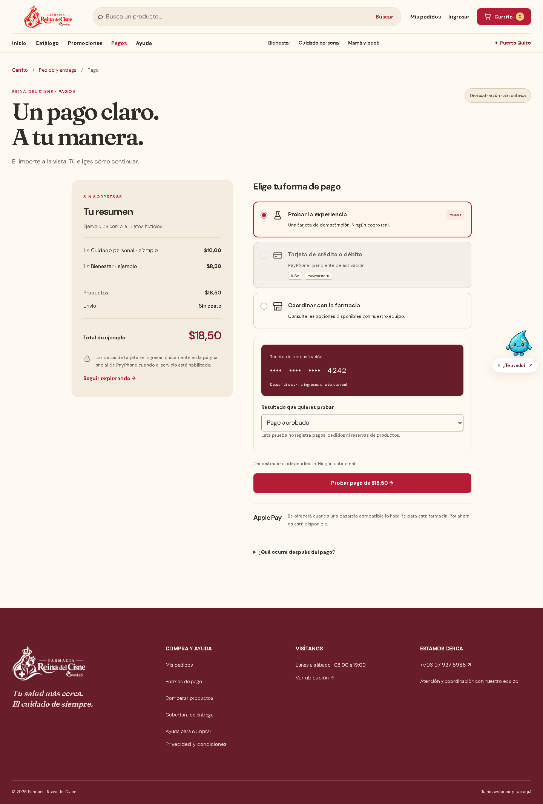

# Pagos, mascota y enlaces — 29 de octubre de 2026

La nueva pestaña mantiene colores, logos y mascotas. Usa una demostración independiente, un resumen privado por pedido y la integración preparada para PayPhone. El propietario confirmó que todavía no tiene cuenta comercial; no hay credenciales ni una conexión bancaria verificada. Apple Pay continúa no disponible hasta una habilitación compatible.

Se retiraron los controles e iconos de WhatsApp; el contacto continúa por texto en el dominio oficial. Se eliminaron redes sociales sin perfiles conocidos. El enlace acortado de ubicación se sustituyó por una búsqueda explícita de Farmacia Reina del Cisne en Puerto Quito: el enlace anterior resolvía a Consulab y no se considera un punto exacto de la farmacia validado. La navegación de reparto conserva el destino particular de cada pedido.

## Recorrido visible

| Paso | Escritorio | Móvil |
|---|---|---|
| Demostración sin tarjeta real | [Ver pantalla](pruebas/pagos-2026-10-29/demostracion-escritorio.png) | [Ver pantalla](pruebas/pagos-2026-10-29/demostracion-movil.png) |
| Aprobación ficticia, sin cobros ni escrituras comerciales | [Ver resultado](pruebas/pagos-2026-10-29/aprobacion-demostracion-escritorio.png) | [Ver resultado](pruebas/pagos-2026-10-29/aprobacion-demostracion-movil.png) |
| Pedido de una base temporal: total guardado y PayPhone pendiente | [Ver resumen](pruebas/pagos-2026-10-29/pedido-escritorio.png) | [Ver resumen](pruebas/pagos-2026-10-29/pedido-movil.png) |

Las capturas usan API local y SQLite temporal. Los artículos, usuarios, importes y pedidos son sintéticos; no representan ventas, cobros o respuestas reales de PayPhone. La demostración tampoco escribe pagos. El archivo `manifest.json` contiene los hashes de las seis imágenes.

## Comprobaciones

- Node: **258/258**, sin omisiones, incluyendo migraciones/API/importación en PostgreSQL temporal real y SQLite. PayPhone se sustituye por respuestas controladas.
- Tienda histórica: **38/38**, sin omisiones.
- Pages y API entre orígenes: **22/22**, sin omisiones.
- Suite de navegador completa: **112/112**, sin fallos, omisiones ni reintentos. Incluye 30 escenarios de pagos y el recorrido de los tres roles.
- Dos escenarios adicionales de resumen: **2/2**, a 320 y 375 px. Primero reprodujeron nombres válidos sin espacios que ocultaban importes; la corrección conserva texto completo y precio dentro del panel.
- Ambos esquemas validados con Prisma **6.19.3**, artefacto Pages generado, sin dependencias nuevas y auditoría npm con cero vulnerabilidades.

La comprobación pública inicial también detectó que la lista de publicación de Pages omitía `pagos.html`. Se corrigió el empaquetado y se añadió una comprobación que exige todas las pantallas generadas, además del recorrido de pagos entre orígenes.

Los cambios de sesión, intentos de otro entorno, refresco de estado, destinos de redirección, permisos, IVA/envío e idempotencia tienen cobertura específica. La ejecución inicial de PostgreSQL detectó un error del fixture de retiro con zona de envío; se corrigió el fixture conservando la validación. La ejecución completa posterior aprobó 258 casos. Los 28 archivos históricos de capturas se restauraron y verificaron por hash; las nuevas capturas se guardan aparte.

La migración aditiva `202610290008_payments` se aplicó en Supabase tras verificar una copia privada completa. Los hashes y conteos de las 18 tablas existentes se conservaron; `Pago` quedó vacío, con RLS y sin acceso directo de los roles públicos. No se crearon pagos, usuarios o pedidos de prueba en producción.

El cambio conserva las tres capas y añade `Pago` como entidad número 19, sin eliminar las anteriores. La [guía de PayPhone](PAGOS-Y-PAYPHONE.md) detalla contrato, activación, conciliación y límites. Una intención de pago no confirma ni entrega un pedido y no emite factura SRI. No se han probado pagos con una cuenta real o de pruebas del proveedor.

## Publicación

La evidencia de despliegue y comprobación pública se actualizará al terminar la publicación en los servicios existentes. Las pruebas públicas no utilizan cuentas comerciales válidas ni crean pedidos o cobros de prueba.
