# Recorrido completo: cliente, administrador y repartidor

Demostración del 28 de octubre de 2026. Se probaron formularios, botones y órdenes reales de la aplicación contra una API y SQLite temporales. Los usuarios, productos, pedidos, importes, dirección y GPS de estas capturas son sintéticos. **La tarifa real de Puerto Quito no se cambió.**

El recorrido visual pasó 2/2 en escritorio y móvil con el proveedor OpenStreetMap real, sin errores JavaScript ni fallos de limpieza. No se realizó una llamada, navegación física, cobro, envío de mensajes o emisión SRI. La suite general y publicación se registran por separado en [la evidencia del recorrido](pruebas/recorrido-roles-2026-10-28.json).

## Correcciones

- Acceso inferior al carrito en catálogo y ficha, con cantidad, teclado y espacio para la mascota. Se oculta para personal, carrito vacío y sesión pendiente.
- Actualizar Entregas renueva pedidos, zonas y repartidores y conserva página, selección y formularios sin guardar.
- Provincias escritas con distintas mayúsculas o espacios se corresponden con la opción canónica del formulario.
- Códigos completos visibles para Farmi. Sus desplegables y foco se conservan al actualizar la bandeja.

## Las doce etapas

### 1. Cliente: registro e inicio de sesión

Se crea una cuenta sintética desde el formulario. Sus pedidos y su seguimiento quedan asociados a esa cuenta.

[Ver escritorio](pruebas/recorrido-roles-2026-10-28/escritorio/01-cliente-registrado.png) · [Ver móvil](pruebas/recorrido-roles-2026-10-28/movil/01-cliente-registrado.png)

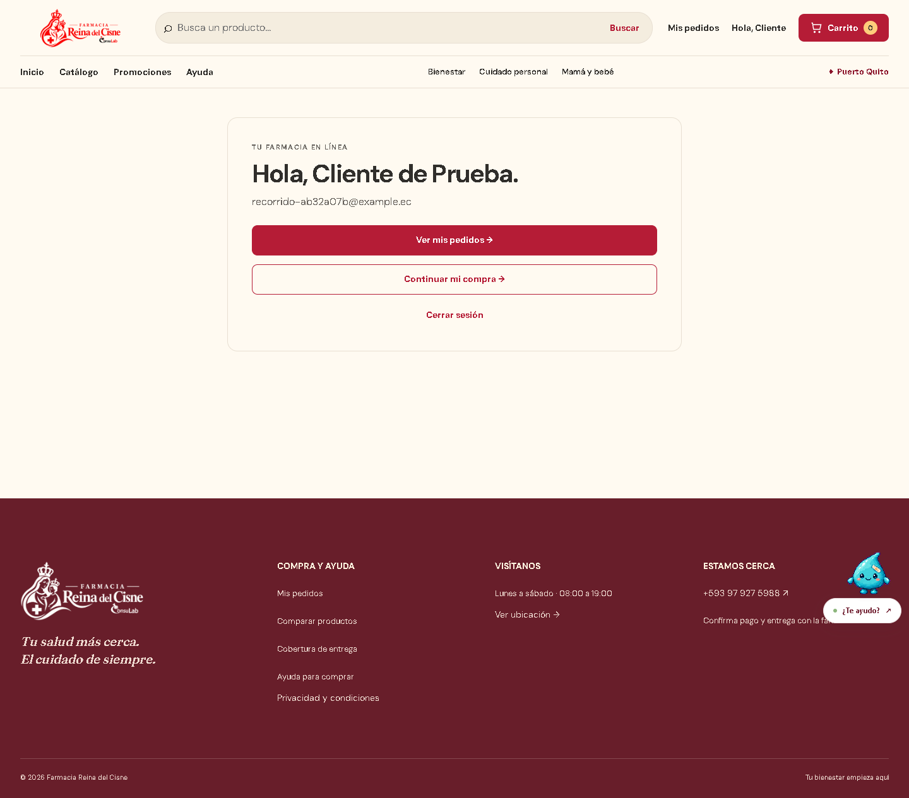

### 2. Administrador: órdenes de precio y promoción

Farmi cambia un precio a USD 12,50 y publica un descuento de 20 %. El producto de prueba queda a USD 10,00. Las escrituras usan la API y la sesión administrativa.

[Ver escritorio](pruebas/recorrido-roles-2026-10-28/escritorio/02-farmi-precio-y-promocion.png) · [Ver móvil](pruebas/recorrido-roles-2026-10-28/movil/02-farmi-precio-y-promocion.png)

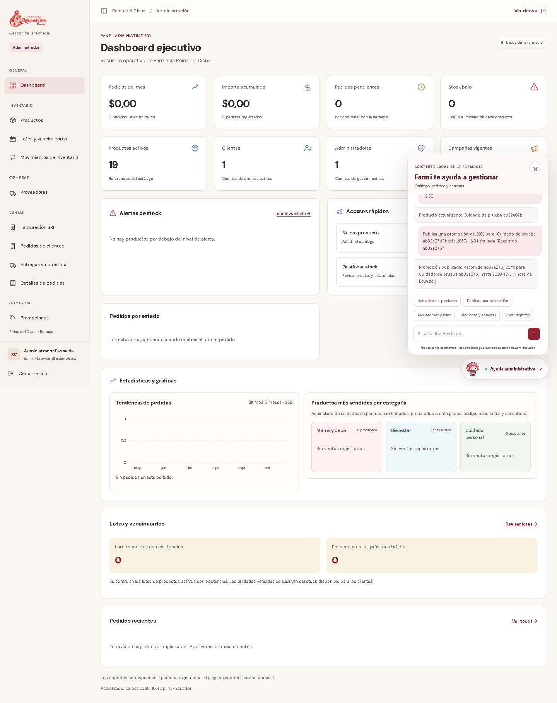

### 3. Administrador: zona y repartidor

Se crea un repartidor desde el formulario y una zona de demostración en Puerto Quito. Los códigos completos se muestran para utilizarlos en las órdenes de Farmi.

[Ver escritorio](pruebas/recorrido-roles-2026-10-28/escritorio/03-admin-zona-pendiente-y-repartidor.png) · [Ver móvil](pruebas/recorrido-roles-2026-10-28/movil/03-admin-zona-pendiente-y-repartidor.png)

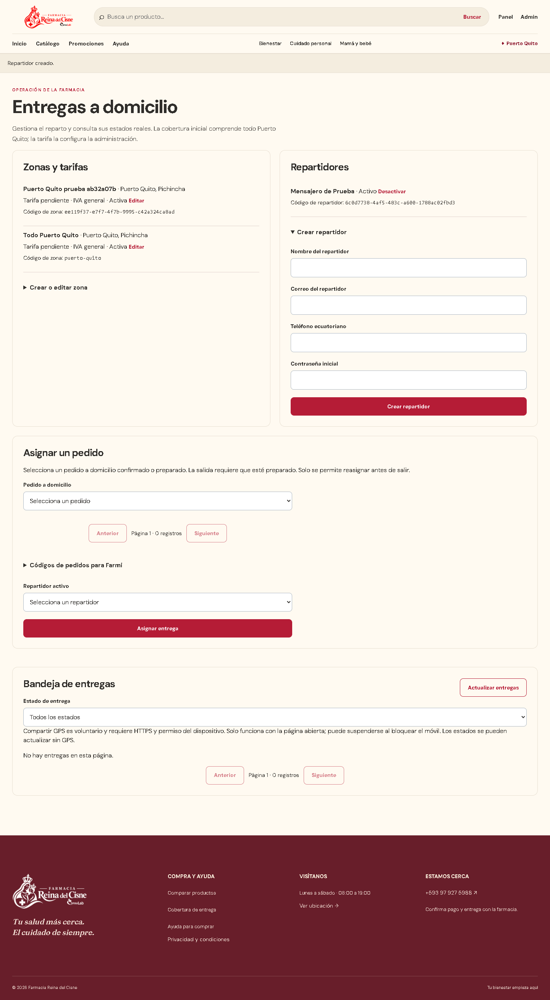

### 4. Cliente: Productos y carrito inferior

El catálogo muestra la promoción. Al añadir el artículo aparece la barra inferior con la cantidad y Ver carrito; también está disponible en la ficha.

[Ver escritorio](pruebas/recorrido-roles-2026-10-28/escritorio/04-catalogo-descuento-y-barra-inferior.png) · [Ver móvil](pruebas/recorrido-roles-2026-10-28/movil/04-catalogo-descuento-y-barra-inferior.png)

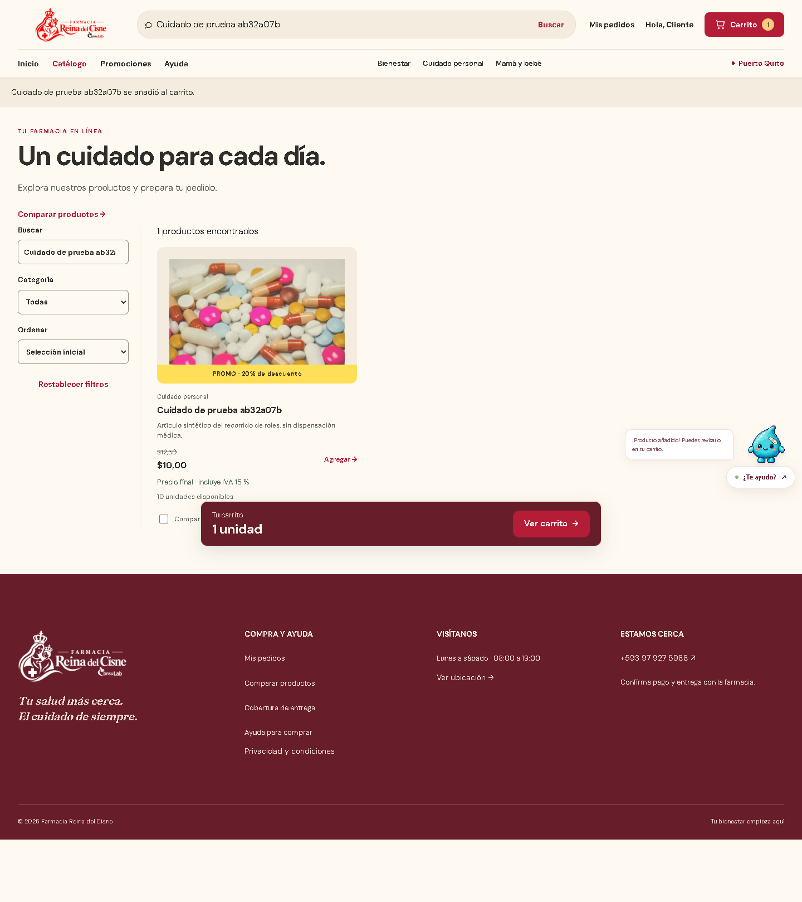

### 5. Cliente: carrito con imagen y cantidades

El carrito conserva imagen, nombre, cantidad, precio y desglose fiscal. Es una compra de prueba, sin cobro.

[Ver escritorio](pruebas/recorrido-roles-2026-10-28/escritorio/05-carrito-con-imagen.png) · [Ver móvil](pruebas/recorrido-roles-2026-10-28/movil/05-carrito-con-imagen.png)

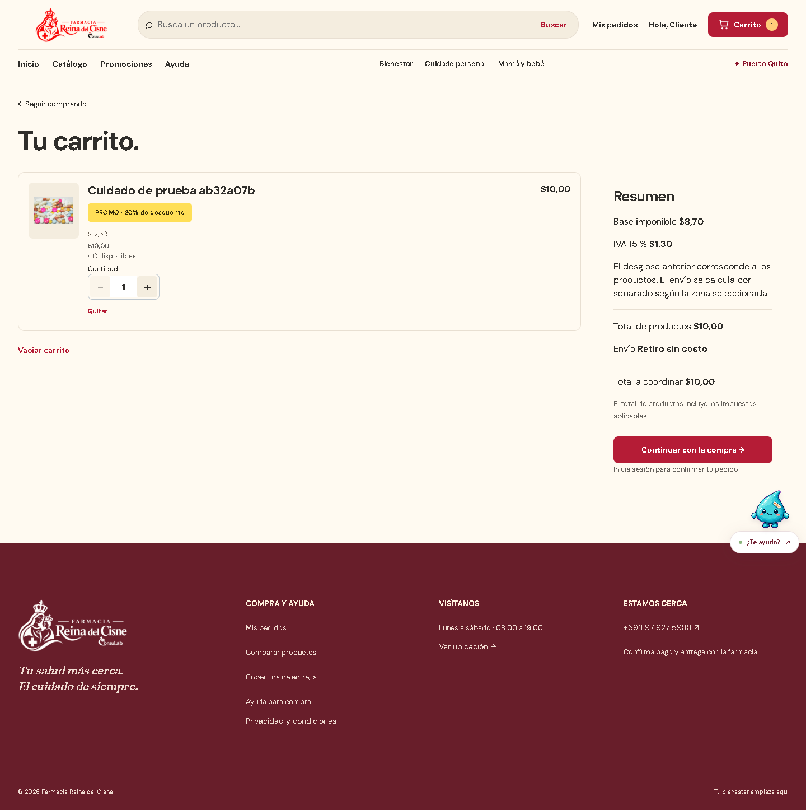

### 6. Cliente: tarifa aún no definida

La entrega no puede confirmarse mientras la tarifa de la zona esté pendiente. La dirección escrita se conserva.

[Ver escritorio](pruebas/recorrido-roles-2026-10-28/escritorio/06-checkout-tarifa-pendiente.png) · [Ver móvil](pruebas/recorrido-roles-2026-10-28/movil/06-checkout-tarifa-pendiente.png)

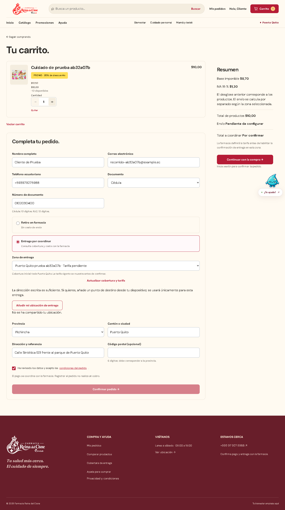

### 7. Administrador y cliente: tarifa modificable

Farmi configura USD 2,50 en la zona sintética. El cliente actualiza la cotización y ve el total. Después se cambia a USD 3,00: el primer intento recibe 409, muestra USD 13,00 y requiere una segunda confirmación.

[Ver escritorio](pruebas/recorrido-roles-2026-10-28/escritorio/07-tarifa-actualizada-y-total.png) · [Ver móvil](pruebas/recorrido-roles-2026-10-28/movil/07-tarifa-actualizada-y-total.png)

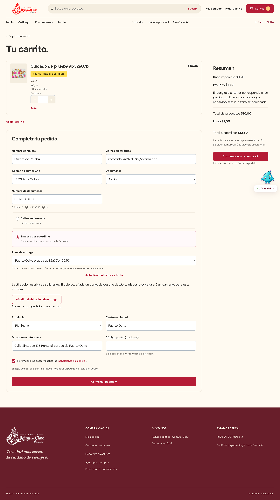

### 8. Cliente: pedido de demostración confirmado

Se guarda un único pedido en SQLite temporal: USD 10,00 de productos y USD 3,00 de envío. No es una venta real de producción.

[Ver escritorio](pruebas/recorrido-roles-2026-10-28/escritorio/08-pedido-real-confirmado.png) · [Ver móvil](pruebas/recorrido-roles-2026-10-28/movil/08-pedido-real-confirmado.png)

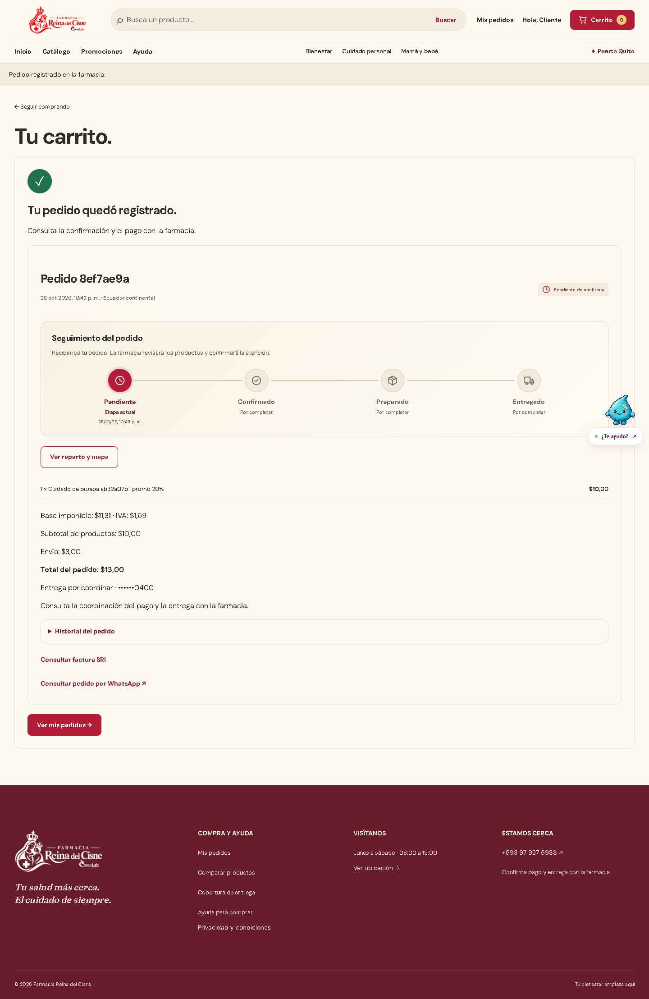

### 9. Administrador: preparación y asignación por Farmi

Las órdenes confirman y preparan el pedido, y lo asignan al repartidor indicado. Actualizar Entregas incorpora el pedido sin recargar la página ni perder borradores.

[Ver escritorio](pruebas/recorrido-roles-2026-10-28/escritorio/09-pedido-y-repartidor-asignados-por-farmi.png) · [Ver móvil](pruebas/recorrido-roles-2026-10-28/movil/09-pedido-y-repartidor-asignados-por-farmi.png)

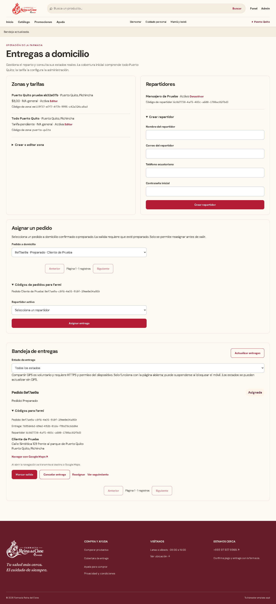

### 10. Repartidor: destino, salida, GPS y llegada

La cuenta de repartidor entra en su bandeja. Se comprueba el destino del enlace de Google Maps y se comparte GPS sólo al pulsar el botón. Al marcar llegada aparece Llamar al destinatario. No se abre Google Maps ni se realiza una llamada.

[Ver escritorio](pruebas/recorrido-roles-2026-10-28/escritorio/10-repartidor-llegada-google-maps-y-llamada.png) · [Ver móvil](pruebas/recorrido-roles-2026-10-28/movil/10-repartidor-llegada-google-maps-y-llamada.png)

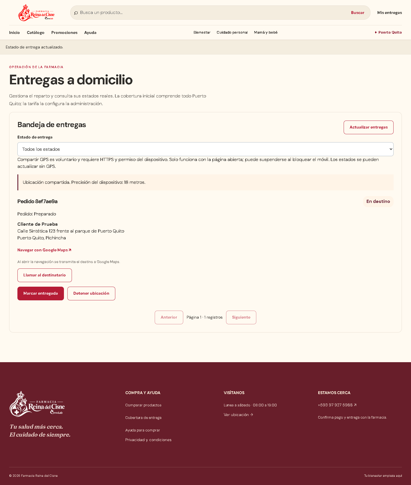

### 11. Cliente: seguimiento privado con mapa real

Tras aceptar cargar el mapa, OpenStreetMap muestra la última posición simulada y su precisión. Se verificaron el canvas de MapLibre y teselas reales HTTP 200: 18 en escritorio y 6 en móvil. El GPS y el destino son sintéticos.

[Ver escritorio](pruebas/recorrido-roles-2026-10-28/escritorio/11-cliente-seguimiento-privado-mapa-voluntario.png) · [Ver móvil](pruebas/recorrido-roles-2026-10-28/movil/11-cliente-seguimiento-privado-mapa-voluntario.png)

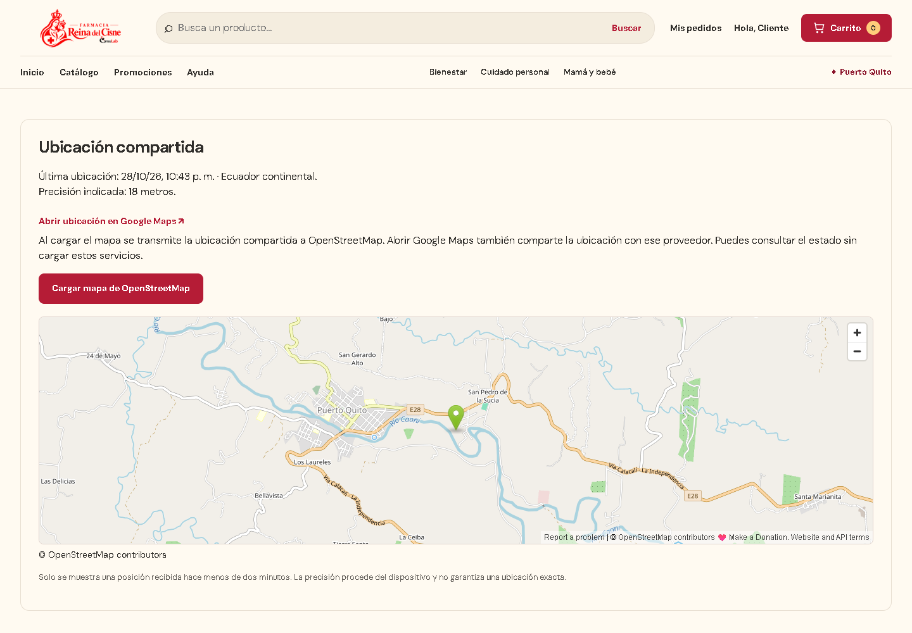

### 12. Cliente y repartidor: cierre y privacidad

Marcar entregada cierra el pedido, detiene el GPS y retira posición, destino y teléfono de la vista operativa. El cliente conserva estados e historial; el mapa desaparece.

[Ver escritorio](pruebas/recorrido-roles-2026-10-28/escritorio/12-cliente-entrega-cerrada-sin-ubicacion.png) · [Ver móvil](pruebas/recorrido-roles-2026-10-28/movil/12-cliente-entrega-cerrada-sin-ubicacion.png)

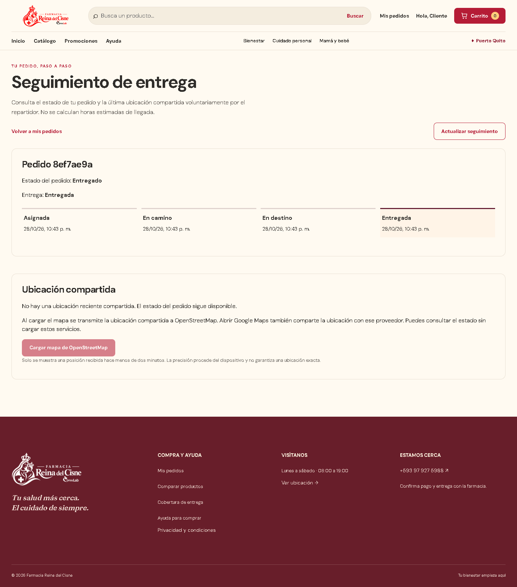

## Órdenes empleadas

Los nombres e identificadores se copian de los registros de prueba. En operación deben utilizarse los códigos reales visibles en administración.

```text
Actualiza el precio de "NOMBRE EXACTO" a 12.50
Publica una promoción de 20% para "NOMBRE EXACTO" hasta 2030-12-31 titulada "Demostración"
Modifica zona "ID-ZONA": tarifaCentavos=250
Modifica zona "ID-ZONA": tarifaCentavos=300
Cambia pedido "ID-PEDIDO" a confirmado
Cambia pedido "ID-PEDIDO" a preparado
Asigna pedido "ID-PEDIDO" a repartidor "ID-REPARTIDOR"
```

Los importes anteriores son ejemplos del ensayo. La tarifa comercial se acuerda con los repartidores y se guarda desde administración; 0 significa envío gratuito explícito y una tarifa pendiente no habilita la confirmación domiciliaria.

El repartidor utiliza Marcar salida → Compartir mi ubicación → Marcar llegada → Llamar al destinatario → Marcar entregada. Compartir GPS no es obligatorio para avanzar estados. El enlace telefónico requiere la decisión del usuario; aquí se verificó su destino sin llamar.

## Reproducción y alcance

```powershell
npx playwright test --config tests/reto2/playwright.config.cjs tests/reto2/role-journey.spec.cjs
$env:PHARMACY_DEMO_LIVE_MAP="true"
npx playwright test --config tests/reto2/playwright.config.cjs tests/reto2/role-journey.spec.cjs
Remove-Item Env:PHARMACY_DEMO_LIVE_MAP
```

El primer comando sustituye sólo el proveedor del mapa por un fixture claramente rotulado para que la regresión no dependa de una red externa; la API de negocio sigue siendo real y temporal. El segundo exige cargar OpenStreetMap real. Ambos impiden ejecutar las escrituras contra un host distinto de localhost/127.0.0.1.

Las capturas de esta galería corresponden al segundo modo. [Manifest de imágenes](pruebas/recorrido-roles-2026-10-28/manifest.json), [evidencia escritorio](pruebas/recorrido-roles-2026-10-28/escritorio/evidencia.json) y [evidencia móvil](pruebas/recorrido-roles-2026-10-28/movil/evidencia.json). Se mantienen fechas y precisión de la aplicación. La prueba no acredita GPS físico continuo, entrega física ni llamada realizada.
