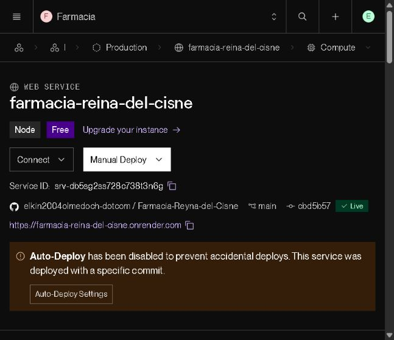

# Reparto móvil — verificación del 1 de noviembre de 2026

La app complementaria conserva la tienda HTML/CSS/JavaScript y el backend Express/Prisma 6. Añade GPS nativo durante una entrega activa, navegación con Google Maps, llamada al marcar llegada y sesiones renovables de repartidor. El framework del Reto 3 sigue aplazado por decisión del propietario.

## Fuente y publicación

- [PR 12 integrada](https://github.com/elkin2004olmedoch-dotcom/Farmacia-Reyna-del-Cisne/pull/12), commit `cbd5b57d3f0ee6c43f43f858cacaa0ff56f615e2`. Su árbol es idéntico al commit de código comprobado `2fcbd2dcc25a263f57a70b22fed84563e494a6ce`.
- Backend existente: [farmacia-reina-del-cisne.onrender.com](https://farmacia-reina-del-cisne.onrender.com). Render confirmó **Live** para `cbd5b57`, con compilación y migración PostgreSQL aprobadas. Se aprobaron 10 comprobaciones de API publicadas: salud, bloqueo anónimo, rechazo de cliente/admin en la app, acceso de repartidor, rotación, reintento idempotente, lectura de sus entregas, logout y rechazo del JWT revocado. Solo se utilizó la cuenta sintética de prueba; no se modificaron pedidos ni se enviaron ubicaciones reales.
- El propietario decidió conservar **Render Free**. No se modificaron facturación, capacidad ni Auto-Deploy. El servidor puede suspenderse por inactividad y esta entrega no garantiza disponibilidad 24/7.
- [Descarga Android y suma SHA256 en GitHub](https://github.com/elkin2004olmedoch-dotcom/Farmacia-Reyna-del-Cisne/releases/tag/reparto-v0.1.0-pruebas): APK de depuración para evaluación. El digest del archivo publicado coincide con el verificado localmente. iOS dispone de proyecto y build para simulador sin firma; falta aprovisionamiento para instalar en iPhone. El propietario no tiene Apple Developer todavía.



[Resultados públicos sin credenciales](pruebas/reparto-movil-2026-11-01.json).

## Pruebas de software

| Comprobación local | Resultado |
|---|---:|
| Node/backend, SQLite y PostgreSQL temporales | 287/287 |
| Motor, adaptador y configuración móvil | 49/49 |
| Interfaz móvil, teclado, 360/390 px y Axe | 10/10 |
| Navegador MVC: escritorio y móvil | 128/128 |
| Pages y API en orígenes separados | 22/22 |
| **Total** | **496 aprobadas** |

Los reportes no presentan fallos, omisiones ni pruebas inestables. Los sustitutos de sensores y las bases temporales no prueban continuidad física del GPS.

GitHub también aprobó [Node, PostgreSQL y navegadores](https://github.com/elkin2004olmedoch-dotcom/Farmacia-Reyna-del-Cisne/actions/runs/41360119990) y [tests móviles, Android e iOS para simulador](https://github.com/elkin2004olmedoch-dotcom/Farmacia-Reyna-del-Cisne/actions/runs/41360119964) sobre el código integrado. El job Node ejecutó además las pruebas históricas y las 16 pruebas de sesión/propiedad móvil en PostgreSQL temporal. Los 92 casos del servicio .NET independiente no se repitieron en esta tarea.

Android: `assembleDebug lintDebug` aprobado, **0 errores y 19 advertencias** de plantillas/dependencias. Auditoría npm móvil: **0 vulnerabilidades**. La firma v2 del APK fue verificada con `apksigner`; es una firma Android Debug, no de distribución. Una revisión independiente comprobó que `assets/public/app.js` coincide exactamente con el bundle generado.

APK de 5.622.178 bytes, SHA256:

```text
537d0b0ab5f3e5f365e5df05f4b4333f9115e6a409885cde39c2a7e488180cbd
```

## Seguridad y consistencia

JWT móvil de 15 minutos en memoria, renovación rotatoria de hasta 30 días en Keychain/Keystore, sin contraseñas incrustadas. Solo el rol repartidor puede iniciar sesión en la app. La API verifica usuario activo, rol, versión y revocación en cada petición. La tabla de sesiones conserva hashes; PostgreSQL habilita RLS y revoca acceso público, `anon` y `authenticated`.

La propiedad transaccional del seguimiento evita que otra pestaña o sesión borre la muestra del dispositivo activo. Cancelar/finalizar o revocar retira la propiedad y las coordenadas. Se envía únicamente la última muestra reciente, con una petición simultánea, espera mínima y recuperación de red/versiones; no se guarda una ruta histórica.

Las revisiones independientes reprodujeron y corrigieron pérdida de sesión al volver a iniciar acceso sin red, cierre local falsamente confirmado ante error de almacén y comparación de milisegundos fraccionarios de CoreLocation. Se añadieron regresiones para esos comportamientos.

Ambos proveedores recibieron migraciones aditivas: tabla `SesionMovil`, relación nullable de seguimiento e índices utilizados por las consultas. El importador mantiene las 20 entidades y su orden referencial. No se eliminaron tablas, columnas ni registros comerciales.

## Lo que falta comprobar físicamente

Seguir [la guía de instalación y aceptación](../mobile/README.md) con un Android y un iPhone reales y pedidos sintéticos separados: bloqueo de pantalla durante 30 minutos, Maps abierto, renovación del JWT, corte/retorno de red, batería, retirada de permisos y finalización administrativa. No hay teléfonos conectados en esta verificación. No se acreditan seguimiento con el dispositivo apagado/cerrado forzosamente ni persistencia Android ante corte abrupto: la biblioteca utiliza `SharedPreferences.apply()`.

Se sincronizaron únicamente los archivos de esta tarea con la carpeta del propietario después de comparar cada destino con su base o candidato. Se regeneraron ambos clientes Prisma 6.19.3; no se migró ni sembró la base local del propietario. El clúster PostgreSQL temporal utilizado en pruebas quedó detenido. No se emitieron cobros, facturas, llamadas ni pedidos comerciales como parte de estas comprobaciones.
